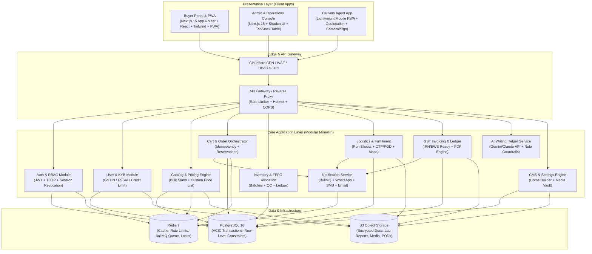
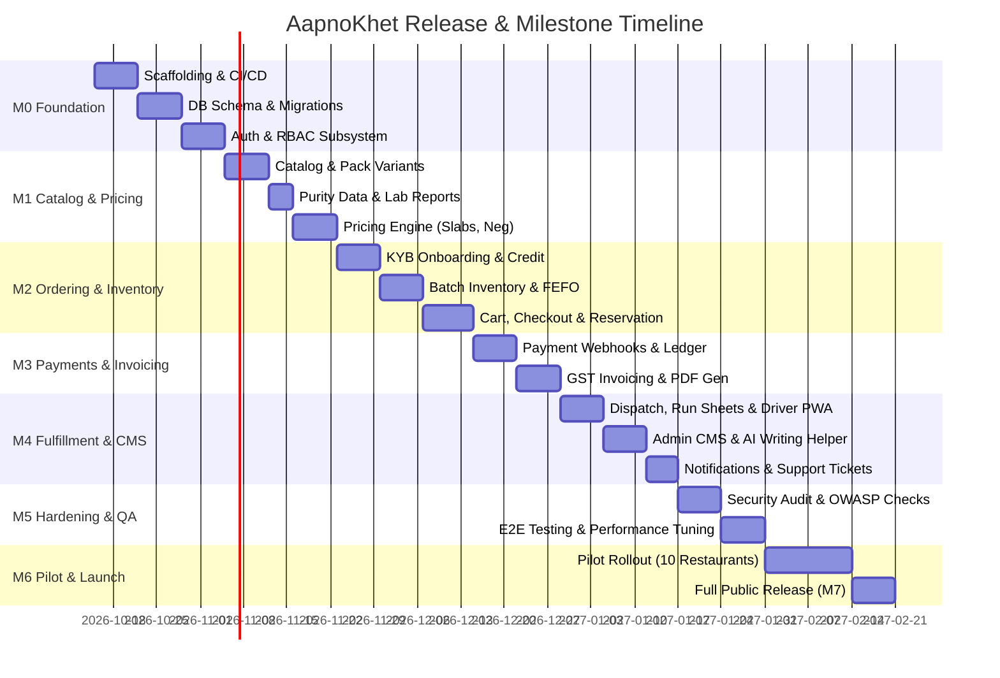
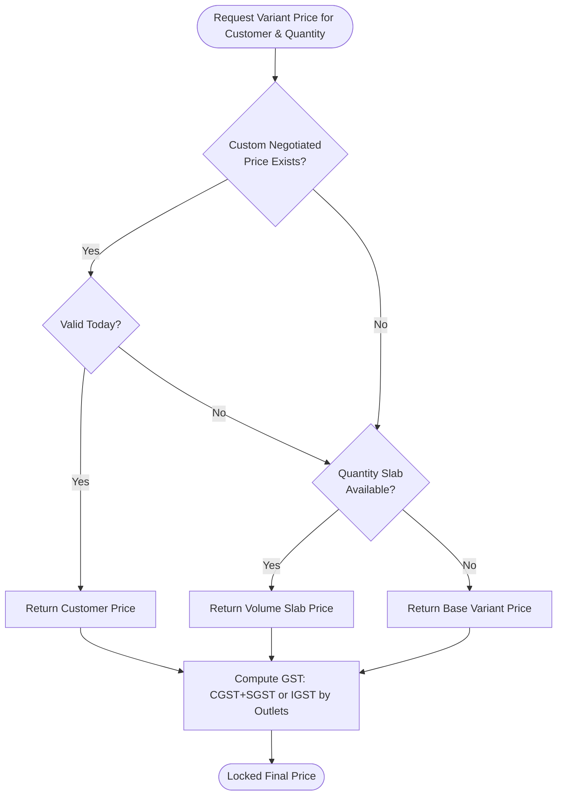
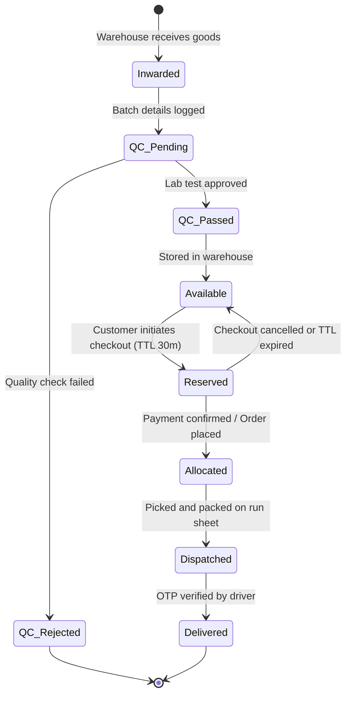
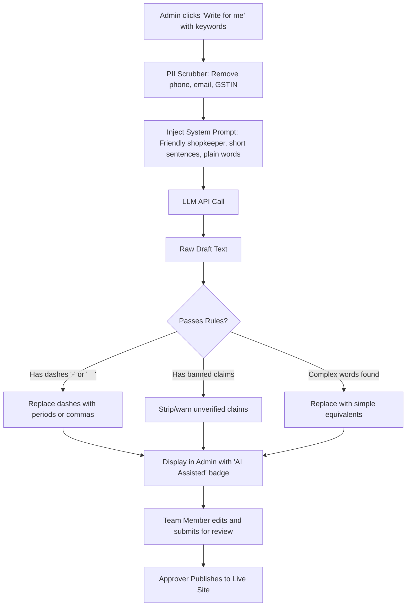

# AapnoKhet B2B E-Commerce Platform — Master Implementation Plan

> **Document Version:** 1.0  
> **Source Baseline:** [PRD v1.0 (`prd (3).md`)](file:///c:/Users/Dell/Desktop/Aapnokhet.com/prd%20(3).md)  
> **Business Model:** Pure Food B2B Direct-Supply (AapnoKhet is the sole seller; no third-party vendor signup)  
> **Target Audience:** Restaurants, Hotels, Caterers, Cloud Kitchens  
> **Primary Geographies:** Tier 1 / Tier 2 Indian Metros (GST, FSSAI, UPI/NetBanking compliant)

---

## 1. Executive Summary & Architectural Strategy

### 1.1 Core Business Constraints & Platform Identity
1. **Single-Seller Inventory Model:** Unlike multi-vendor marketplaces (e.g., Udaan/Amazon), AapnoKhet operates on an owned-inventory B2B direct model (like Blinkit/Instamart for commercial kitchens). All procurement happens off-platform; inventory inwards into AapnoKhet warehouses, where it is lab-tested and sold directly.
2. **Batch Purity & FEFO Discipline:** Every perishable and commodity unit is tracked by `BATCH`, manufacturing date, expiry date, and laboratory purity certificate. Stock allocation enforces **FEFO (First-Expiry-First-Out)**.
3. **Dynamic B2B Pricing:** Pricing must handle base variant pricing, tiered volume bulk slabs, customer-negotiated contracted rates, and daily commodity rate revisions with effective timestamp locking.
4. **Operations & Admin Autonomy:** Business operations (marketing, banners, pricing, CMS, delivery zones, order cutoffs) must be 100% manageable via the Admin Console without developer intervention.
5. **AI Writing Helper:** In-house AI assistant strictly adheres to human-friendly, plain language rules (no dashes, no unverified claims, fact-grounded).

---

### 1.2 Technology Stack Architecture



| Layer | Recommended Choice | Rationale |
|---|---|---|
| **Frontend Framework** | Next.js (`next@latest`) + React + Tailwind CSS | Responsive Buyer Portal, Admin Console, and Delivery Agent PWA with SSR/SEO and modern rich UI. |
| **Backend Runtime & Framework** | Python (Python 3.14) + FastAPI + Pydantic v2 | High-performance asynchronous API, auto-generated OpenAPI schemas, robust data validation and typing. |
| **Database & ORM** | PostgreSQL 16 / SQLite (local dev) + SQLAlchemy / SQLModel | Relational integrity, row-level locking (`SELECT ... FOR UPDATE`), transaction isolation for credit accounts and inventory batches. |
| **Caching & Background Tasks** | Redis + Celery / BackgroundTasks / Async Queues | Session management, mutex locks for inventory reservation, asynchronous task processing (invoicing, notifications). |
| **Object Storage & Uploads** | Local / S3-compatible Object Storage | Secure storage for KYB documents, lab report PDFs, product images, and POD photos. |
| **Payment Gateway** | Razorpay / Cashfree Adapter (UPI, NetBanking, Cards) | Seamless B2B virtual accounts, UPI QR, and cryptographic webhook verification. |
| **Messaging** | WhatsApp Business API + SMS (MSG91) + Email | Automated notification dispatch for order updates, dispatch OTPs, and invoices. |

---

## 2. Master Milestone Roadmap (M0 to M7)

The roadmap is structured into 8 progressive delivery milestones aligned with PRD Section 17.



---

## 3. Detailed Phase-by-Phase Technical Work Breakdown

### Phase 0: Monorepo Foundation, Database Schema & Auth (Milestone M0)
**Duration:** 3 Weeks  
**Primary Goal:** Establish rock-solid infrastructure, database schemas, RBAC, and audit trail foundations.

#### Tasks:
1. **Repository Setup (Turborepo):**
   - `apps/buyer`: Customer-facing Next.js PWA.
   - `apps/admin`: Operations and executive management portal.
   - `apps/driver`: Lightweight mobile PWA for delivery executives.
   - `packages/database`: Prisma / Drizzle ORM client, migration scripts, and seeders.
   - `packages/shared`: Shared TypeScript types, Zod schemas, validation rules, and formatters.
   - `packages/ui`: Shared design system component primitives.
2. **PostgreSQL Database Schema Initialization:**
   - Execute baseline DDL migrations for 26 core tables defined in PRD Section 8.4 and Section 5B.7:
     - Auth: `COMPANY`, `USER`, `ROLE`, `PERMISSION`, `ROLE_PERMISSION`, `ADDRESS`.
     - Catalog: `CATEGORY`, `PRODUCT`, `PRODUCT_VARIANT`, `PRICE_SLAB`, `CUSTOMER_PRICE`, `LAB_REPORT`.
     - Inventory: `WAREHOUSE`, `BATCH`, `STOCK_MOVEMENT`, `STOCK_RESERVATION`.
     - Order & Ledger: `CART`, `CART_ITEM`, `ORDER`, `ORDER_ITEM`, `ORDER_STATUS_HISTORY`, `CREDIT_ACCOUNT`, `LEDGER_ENTRY`.
     - Logistics: `VEHICLE`, `DRIVER`, `DELIVERY`, `DELIVERY_EVENT`, `PROOF_OF_DELIVERY`.
     - Invoicing & Support: `INVOICE`, `CREDIT_NOTE`, `PAYMENT`, `REFUND`, `TICKET`, `TICKET_MESSAGE`.
     - Admin & CMS: `PAGE`, `PAGE_SECTION`, `BANNER`, `MEDIA_FILE`, `DELIVERY_ZONE`, `TIME_SLOT`, `MESSAGE_TEMPLATE`, `SETTING`, `AI_REQUEST`.
3. **Authentication & RBAC Core Engine:**
   - JWT authentication in encrypted `httpOnly`, `Secure`, `SameSite=Lax` cookies.
   - 15-minute access token + rotating refresh tokens with reuse detection.
   - Mandatory TOTP 2FA for internal administrative roles (`Super Admin`, `Finance`, `Sales`).
   - Role-Permission resolution middleware implementing strict deny-by-default logic (`hasPermission(code)`).
4. **Tamper-Evident Audit Logging Subsystem:**
   - Database trigger / middleware on `AUDIT_LOG` recording `user_id`, `action`, `entity`, `entity_id`, `before_state (JSONB)`, `after_state (JSONB)`, `ip_address`, and UTC timestamp.
   - Prohibit updates and deletes on the `AUDIT_LOG` table via PostgreSQL table rules.

---

### Phase 1: Catalog, Purity Data & Pricing Engine (Milestone M1)
**Duration:** 2.5 Weeks  
**Primary Goal:** Deliver product catalog, purity verification (lab test attachments), and dynamic tiered pricing.

#### Tasks:
1. **Catalog Domain Implementation:**
   - Categories: Wheat Flour, Rice, Pulses, Spices, Dairy, with sub-categories.
   - Product Variants: Standard pack sizes (1 kg, 5 kg, 25 kg, 50 kg bag, 1 L, 15 kg tin), HSN codes, GST rates (0%, 5%, 12%), shelf life, and storage requirements.
   - Perishable flag for dairy with temperature requirements.
2. **Purity & Lab Report Architecture:**
   - Attachment of lab test reports (PDF) per product and batch.
   - Parameters tracked: Moisture %, Foreign matter %, Adulteration test result, Aflatoxin / Pesticide status, Microbial count, and FSSAI lab license number.
   - Secure PDF upload and storage in S3 with public signed view URLs.
3. **Multi-Tier Pricing Engine:**
   - Priority resolution hierarchy:
     $$\text{Price} = \begin{cases} \text{Negotiated Customer Price} & \text{if active and valid} \\ \text{Volume Tier Slab Price} & \text{if quantity matches min/max range} \\ \text{Base Variant Price} & \text{default} \end{cases}$$
   - Scheduled daily price revisions: Support `effective_from` timestamps.
   - Bulk Excel/CSV price import:
     - Parse, validate schemas, detect anomalies (>15% variance requires Super Admin confirmation).
     - Dry-run preview with line-by-line error reporting before DB commit.
4. **Buyer Catalog UI:**
   - Fast full-text search with instant autocomplete.
   - Pack-size switcher with live price and GST breakdown.
   - Badge indicators for purity tests, FSSAI certified, and stock availability.

---

### Phase 2: Customer Onboarding, KYB & Credit Accounts (Milestone M1–M2)
**Duration:** 2 Weeks  
**Primary Goal:** Implement restaurant registration, GSTIN verification, KYB document review, and credit terms.

#### Tasks:
1. **Registration & Multi-Outlet Structure:**
   - Restaurant registration capturing Business Legal Name, Trade Name, GSTIN, PAN, and FSSAI number.
   - OTP verification on Mobile (MSG91/WhatsApp) and Email.
   - Multi-address outlet configuration: Branch locations with GPS coordinates and pincode verification.
2. **Pincode & Serviceability Engine:**
   - Master delivery zone mapping (`DELIVERY_ZONE`, `PINCODE`, `TIME_SLOT`).
   - Cutoff time validation (e.g., orders placed before 8 PM eligible for next-morning 6 AM delivery).
3. **KYB Document Review Dashboard:**
   - File upload pipeline (GST certificate, FSSAI license, FSSAI declaration, canceled cheque).
   - Antivirus scanning (ClamAV) and MIME-type validation.
   - Sales Manager verification portal: Approve, Reject (with mandatory reason), or Request Re-upload.
4. **Credit Account Management:**
   - Credit limit assignment (e.g., ₹2,00,000) and payment terms (Net-7, Net-15, Net-30).
   - Real-time outstanding calculation:
     $$\text{Available Credit} = \text{Credit Limit} - (\text{Unpaid Invoices} + \text{Pending Orders})$$
   - Automatic order block when account has overdue unpaid invoices exceeding grace days.

---

### Phase 3: Inventory Engine with FEFO & QC Inwarding (Milestone M2)
**Duration:** 2.5 Weeks  
**Primary Goal:** Warehouse stock control, batch management, FEFO allocation, and atomic reservation.

#### Tasks:
1. **Goods Receipt Note (GRN) & QC Inwarding:**
   - Inward entry screen for warehouse team: SKU, Quantity, Batch Number, Mfg Date, Expiry Date, Storage Warehouse.
   - Quality Control (QC) status gate (`Pending`, `Passed`, `Rejected`).
   - Stock only increments to available status upon QC approval and lab report attachment.
2. **FEFO (First-Expiry-First-Out) Allocation Algorithm:**
   - When an order item is prepared, allocate stock sequentially from batches with the closest `expiry_date`:
     ```sql
     SELECT id, batch_no, (qty_available - qty_reserved) AS allocatable
     FROM batches
     WHERE variant_id = :variantId 
       AND warehouse_id = :warehouseId 
       AND qc_status = 'PASSED' 
       AND expiry_date > CURRENT_DATE
       AND (qty_available - qty_reserved) > 0
     ORDER BY expiry_date ASC
     FOR UPDATE;
     ```
3. **Atomic Stock Reservation Engine:**
   - Two-phase reservation: When checkout begins, create `STOCK_RESERVATION` records with a 30-minute TTL.
   - If payment succeeds, convert reservations to permanent `ORDER_ITEM` allocations.
   - If payment fails or times out, a BullMQ background worker automatically releases reservations.
4. **Stock Adjustments & Expiry Alerts:**
   - Manual adjustment workflow with required reason codes (`Damaged`, `Spillage`, `Audit Variance`).
   - Automated nightly job calculating batches expiring within 30 days and triggering warehouse alerts.

---

### Phase 4: Cart, RFQ & Order Lifecycle Orchestration (Milestone M2)
**Duration:** 2.5 Weeks  
**Primary Goal:** High-speed ordering, MOQ enforcement, bulk RFQ, reordering, and multi-user restaurant approvals.

#### Tasks:
1. **Cart & MOQ Engine:**
   - Persistent cart synced across devices for registered buyers.
   - Strict MOQ validation (e.g., minimum 25 kg bag for wheat flour).
   - Real-time price lock: When an order is placed, line-item unit prices and tax rates are frozen.
2. **One-Click Reorder Flow:**
   - "Order Again" button on past orders that clones previous order items into cart, checks live stock/prices, and allows instant checkout in under 60 seconds.
3. **Staff Spend-Limit & Approval Workflow:**
   - Restaurant Sub-User roles: Chef / Kitchen Staff can create cart and submit orders.
   - If order value exceeds the user's allocated limit, order shifts to `Awaiting_Owner_Approval` state.
   - Owner receives WhatsApp/SMS alert with 1-click approval link.
4. **Request for Quotation (RFQ) Module:**
   - Form for special institutional purchases (e.g., 5+ tons of rice).
   - Sales Manager dashboard to review RFQ and issue custom time-bound quotations.

---

### Phase 5: Payments, Ledger & GST Invoicing Engine (Milestone M3)
**Duration:** 3 Weeks  
**Primary Goal:** Payment gateway webhooks, B2B credit ledger, automated GST tax invoices, and credit notes.

#### Tasks:
1. **Payment Gateway Integration:**
   - Razorpay / Cashfree Orders API integration.
   - Support for UPI Intent/QR, NetBanking (commercial banks), Credit/Debit cards.
   - Webhook handler with mandatory cryptographic HMAC signature verification:
     - Check event ID idempotency in Redis to prevent replay attacks.
     - Update order status atomically inside a DB transaction.
2. **Double-Entry Customer Ledger (`LEDGER_ENTRY`):**
   - Maintain immutable ledger transactions:
     - Debit: Order Invoice Issued (+Amount Due).
     - Credit: Payment Received via Gateway / Bank Transfer (-Amount Due).
     - Credit: Approved Return / Credit Note (-Amount Due).
   - Customer statement download (PDF & CSV).
3. **GST Tax Invoice Generator:**
   - Atomic sequential invoice numbering per Financial Year (e.g., `AK/26-27/004521`).
   - Place of Supply calculation:
     - Intra-state (Same state): CGST (50%) + SGST (50%).
     - Inter-state (Different state): IGST (100%).
   - HSN-wise tax breakdown table.
   - High-fidelity PDF generation using Puppeteer / React-PDF with AapnoKhet FSSAI, GSTIN, and buyer details.
   - Ready data contracts for Indian Government E-Invoice (IRN) and E-Way bill generation.
4. **Credit Note & Refund Workflow:**
   - Finance approval screen for return settlements.
   - Issue GST Credit Note linked to original invoice number.

---

### Phase 6: Fulfillment, Logistics & Driver PWA (Milestone M4)
**Duration:** 2.5 Weeks  
**Primary Goal:** Warehouse dispatch, route assignment, Driver PWA, and tamper-proof Proof of Delivery.

#### Tasks:
1. **Dispatch & Packing Slips:**
   - Generate consolidated warehouse Pick-Lists grouped by batch and aisle.
   - Generate packing slips with customer outlet instructions and cold-chain tags.
2. **Vehicle & Driver Run Sheets:**
   - Fleet manager: Register vehicles (standard vs. refrigerated cold-chain) and drivers.
   - Cold-chain rule: Block assignment of dairy products to non-refrigerated vehicles.
   - Delivery run sheet creation assigning 10–15 orders per delivery vehicle.
3. **Delivery Agent Mobile PWA (`apps/driver`):**
   - Clean, lightweight mobile interface optimized for low network connectivity.
   - Trip view with route sequence and one-tap Google Maps navigation.
   - Status transitions: `Assigned` $\rightarrow$ `Out for Delivery` $\rightarrow$ `Delivered` / `Failed`.
4. **Proof of Delivery (POD) Engine:**
   - OTP verification: 4-digit OTP sent to restaurant receiving manager, entered by driver.
   - Photo capture: Driver captures photo of unloaded sacks/crates at restaurant doorstep.
   - Digital signature: Receiver signs directly on the mobile screen.
   - Timestamp and GPS coordinates captured at POD submission.

---

### Phase 7: Admin Console, Visual CMS & AI Writing Helper (Milestone M4)
**Duration:** 3 Weeks  
**Primary Goal:** Operational command center, complete visual website control, and human-friendly AI writing assistant.

#### Tasks:
1. **Operational Dashboard (`apps/admin`):**
   - KPI cards: Today's Orders, Real-time Sales, Pending KYB Approvals, Batches Expiring in 30 Days, Low Stock Warnings, Late Deliveries.
2. **Full Website Control & Visual CMS (PRD Section 5B):**
   - **Home Page Builder:** Drag-and-drop section reordering, toggle visibility of banners, categories, featured items, and announcement bars.
   - **Banner Manager:** Upload desktop & mobile banner creatives, set target links, and schedule active date-time windows.
   - **Dynamic Page Editor:** Rich-text management for About, Contact, Terms, FAQs, and Policies.
   - **Media Vault:** Asset manager with image resizing, compression, and S3 storage.
   - **System Settings:** Configure delivery fees, free delivery thresholds, service pincodes, cutoff times, and tax settings without code changes.
   - **Content Governance:** Status workflow (`Draft` $\rightarrow$ `InReview` $\rightarrow$ `Approved` $\rightarrow$ `Live`), version history, and 1-click restore.
3. **AI Writing Helper Service (PRD Section 5C):**
   - Dedicated service integrating LLM API (Google Gemini 1.5 Pro / Flash).
   - "Write for me" buttons on product descriptions, banner taglines, FAQ answers, SMS, and email templates.
   - **Strict Rule Enforcement Engine:**
     - Friendly, warm shopkeeper tone.
     - Grade-school vocabulary (automatic conversion: *utilize* $\rightarrow$ *use*, *procure* $\rightarrow$ *get*, *perishable* $\rightarrow$ *spoils quickly*).
     - **NO DASHES RULE:** Regex and post-processing filter strictly removing `-` and `—` and replacing with periods, commas, or "and".
     - **No Unproven Claims:** Banned terms filter (*100% pure*, *best in India*, *cures*) unless verified by lab data.
     - Strict length constraints (product short text: 15–25 words; banner: $\le 8$ words; SMS: $\le 160$ chars).
     - PII Redaction: Automatic scrubbing of phone numbers, emails, and GSTINs prior to prompt dispatch.
     - Review gate: AI outputs are always flagged as "AI-assisted draft" and require human approval before publishing.

---

### Phase 8: Notifications, Customer Support & Ticketing (Milestone M4)
**Duration:** 2 Weeks  
**Primary Goal:** Multi-channel alerting (WhatsApp/SMS/Email) and post-delivery dispute resolution.

#### Tasks:
1. **Notification Worker Subsystem:**
   - BullMQ asynchronous worker handling template rendering and multi-channel dispatch:
     - Events: Order Placed, Order Confirmed, Out for Delivery, Delivered with Invoice PDF, Payment Due Reminder, Low Stock Alert.
     - WhatsApp Business message templates (Meta-approved).
     - Transactional SMS via DLT-approved templates (India regulatory compliance).
2. **Support & Returns Portal:**
   - Post-delivery complaint submission within policy window (e.g., 2 hours for dairy, 24 hours for dry grains).
   - Mandatory photo evidence upload for damaged/spoiled items.
   - Support Agent ticketing console: SLA tracking, chat thread, resolution actions (`Reject`, `Reship`, `Issue Credit Note`).

---

### Phase 9: Testing, Security Hardening, Pilot & Launch (Milestones M5, M6, M7)
**Duration:** 3.5 Weeks  
**Primary Goal:** End-to-end verification, OWASP ASVS L2 security hardening, 10-restaurant pilot, and production launch.

#### Tasks:
1. **Automated Testing Suite (PRD Section 12 & 5D):**
   - **Unit Tests (>80% coverage):** Pricing calculations, GST splits, FEFO batch sorting, credit limit evaluations, AI rule linter.
   - **Integration Tests:** Payment webhook processing, stock reservation concurrency, atomic inventory decrements.
   - **E2E Tests (Playwright):**
     - Complete buyer journey: Registration $\rightarrow$ KYB upload $\rightarrow$ Catalog search $\rightarrow$ Checkout $\rightarrow$ Payment $\rightarrow$ Invoice generation.
     - Driver journey: Order assignment $\rightarrow$ OTP verification $\rightarrow$ POD completion.
     - Admin CMS: Price slab updates, banner scheduling, AI helper generation and approval.
2. **Security & Compliance Hardening (PRD Section 13 & 14):**
   - Zero-trust RBAC API matrix validation (deny-by-default on every route).
   - Parameter tampering verification (ensure client-submitted prices or totals are completely ignored).
   - Data Protection: Mask PAN / bank accounts; comply with India DPDP Act 2023.
   - Static Application Security Testing (Semgrep) & Secret scanning (Gitleaks).
3. **Performance & Stress Testing (k6):**
   - 5,000 concurrent virtual users browsing catalog and placing orders.
   - Target metrics: Page load $<2.5$ s on 4G, search response $<300$ ms, checkout API p95 $<500$ ms.
4. **Milestone M6: Pilot Rollout:**
   - Onboard 10 selected restaurant partners in target pilot zone.
   - Monitor live transactions, driver routes, invoice accuracy, and reorder frequency.
   - Refine UX based on pilot feedback.
5. **Milestone M7: Public Launch:**
   - Transition to full service area rollout; enable monitoring alerts (Sentry, Prometheus, Grafana).

---

## 4. Work Breakdown Structure (WBS) & Sprint Schedule

| Sprint | Weeks | Primary Focus Area | Key Deliverables | Milestone |
|---|---|---|---|---|
| **Sprint 1** | W1–W2 | Core Scaffolding, DB & Auth | Turborepo setup, PostgreSQL DDL migrations, JWT + TOTP 2FA, Audit log trigger | M0 |
| **Sprint 2** | W3–W4 | Catalog, Purity & Pricing | Categories, SKUs, Lab report upload, Slab & Custom pricing engine, Daily price scheduler | M1 |
| **Sprint 3** | W5–W6 | Onboarding, KYB & Credit | KYB upload, GSTIN verification, Pincode zone manager, Credit account ledger | M1–M2 |
| **Sprint 4** | W7–W8 | Inventory & FEFO Engine | Warehouse GRN inwarding, QC workflow, FEFO allocation algorithm, Stock reservation | M2 |
| **Sprint 5** | W9–W10 | Cart, Checkout & Orders | Persistent cart, MOQ rules, 1-click reorder, Staff spend approval, RFQ quotes | M2 |
| **Sprint 6** | W11–W12 | Payments & GST Invoicing | Razorpay integration, Webhook verification, Sequential GST Tax Invoice PDF, Credit notes | M3 |
| **Sprint 7** | W13–W14 | Logistics & Driver PWA | Warehouse pick lists, Vehicle run sheets, Driver PWA with OTP & photo POD | M4 |
| **Sprint 8** | W15–W16 | Admin Visual CMS & AI Helper | Home builder, Banner scheduler, Media vault, AI Writing Helper with strict rules & linter | M4 |
| **Sprint 9** | W17–W18 | Notifications & Support | BullMQ notification worker (WhatsApp/SMS/Email), Returns portal & dispute resolution | M4 |
| **Sprint 10** | W19–W20 | Security Audit & Testing | White/black-box test matrix, OWASP ASVS L2 pen-test, k6 load testing, DR drill | M5 |
| **Sprint 11** | W21–W22 | Pilot Launch (10 Outlets) | Live pilot execution, operational feedback, driver dispatch monitoring, bug fixes | M6 |
| **Sprint 12** | W23 | Production Rollout | General availability launch, marketing ramp-up, executive KPI dashboards | M7 |

---

## 5. Architectural Deep Dives for Critical Modules

### 5.1 Pricing Engine Resolution Logic
The pricing engine must strictly calculate prices on the server. The client cannot send prices or totals.



---

### 5.2 Stock Reservation & FEFO Allocation Lifecycle



---

### 5.3 AI Writing Helper Rule Guardrail Engine (PRD Section 5C)
To guarantee compliance with PRD Section 5C:



---

## 6. Security, Compliance & Governance Checklist

| Security Area | Implementation Requirement | Verification Method |
|---|---|---|
| **Price Tampering** | Server calculates 100% of line item amounts, tax rates, delivery fees, and order totals. | Automated integration test submitting altered prices in payload; assert rejected or recalculated. |
| **Broken Object Level Auth (BOLA/IDOR)** | Enforce `WHERE company_id = :currentUserCompanyId` on all order, invoice, and document queries. | Attempt accessing Order `B` with User from Company `A`; assert 403 Forbidden. |
| **Payment Integrity** | Verify gateway HMAC signature on raw body; check payment amount matches order grand total; idempotency key on event IDs. | Replay identical webhook; simulate altered amount payload; verify both fail. |
| **File Upload Defense** | Inspect magic bytes (file signature); disallow `.exe`, `.sh`, `.php`; rename to random UUID; store in private S3 bucket; serve via signed URLs. | Attempt uploading disguised script file as lab report; assert rejected. |
| **MFA & Admin Security** | Enforce TOTP 2FA for all administrative accounts; session timeout after 15 minutes of inactivity; IP allow-listing. | Attempt admin login with valid password but missing TOTP token; verify rejected. |
| **Data Privacy (DPDP 2023)** | Consent logs at registration; mask PAN in UI (show last 4 characters); encrypt personal identifiers at rest using AES-256. | Audit DB tables and frontend API payloads for plaintext PAN or unmasked PII. |

---

## 7. Immediate Next Steps & Execution Setup

1. **Monorepo Scaffolding:** Initialize repository with Turborepo (`apps/buyer`, `apps/admin`, `apps/driver`, `packages/database`, `packages/shared`).
2. **Database Provisioning:** Setup local PostgreSQL 16 & Redis 7 containers via `docker-compose.yml`.
3. **Schema Deployment:** Generate Prisma / Drizzle schema corresponding to the 26 PRD entities and execute the first migration.
4. **Design System Baseline:** Configure Tailwind CSS and design tokens following brand guidelines for AapnoKhet.
