# Product Requirements Document (PRD)
## AapnoKhet, Pure Food Supply Chain E-Commerce Platform

| Field | Value |
|---|---|
| Document version | 1.0 |
| Date | 10 October 2026 |
| Product type | B2B web platform (responsive web + PWA) |
| Business | AapnoKhet sells pure food (wheat flour, rice, pulses, spices, dairy) to restaurants, like Blinkit or Instamart, but for businesses |
| Market | India (GST, FSSAI, UPI/NetBanking compliance) |
| Diagram format | Mermaid (renders in GitHub, GitLab, VS Code, Obsidian, Notion) |

> **Brand:** AapnoKhet.

---

## Table of Contents

1. Introduction
2. Business Context and Goals
3. Stakeholders and User Roles
4. Scope
5. Functional Requirements
   - 5A. How AapnoKhet Works (No Seller Sign Up)
   - 5B. Admin Panel and Website Control
   - 5C. AI Writing Helper (Simple and Human Language)
   - 5D. Testing the Admin Panel
6. Non-Functional Requirements
7. System Architecture
8. UML and Software-Engineering Diagrams
   - 8.1 Context Diagram
   - 8.2 Data Flow Diagrams (Level 0, 1, 2)
   - 8.3 Use Case Diagram
   - 8.4 ER Diagram
   - 8.5 Class Diagram
   - 8.6 Object Diagram
   - 8.7 Sequence Diagrams
   - 8.8 Activity Diagrams
   - 8.9 State Machine Diagrams
   - 8.10 Communication (Collaboration) Diagram
   - 8.11 Component Diagram
   - 8.12 Package Diagram
   - 8.13 Deployment Diagram
   - 8.14 Network / Security Zone Diagram
   - 8.15 Site Map / Navigation Flow
   - 8.16 User Journey
   - 8.17 Gantt (Roadmap)
   - 8.18 Timing Diagram (textual)
9. Database Design Notes
10. API Specification (summary)
11. UI/UX Requirements
12. Testing Strategy
    - 12.1 White Box Testing (per module)
    - 12.2 Black Box Testing (per module)
    - 12.3 Other Test Types
13. Security Requirements and Checks (per feature)
14. Compliance and Legal (India)
15. Deployment, DevOps and Monitoring
16. Risks and What we do about it
17. Release Plan and Milestones
18. Success Metrics (KPIs)
19. Appendix (glossary, assumptions, open questions)

---

# 1. Introduction

## 1.1 Purpose
This document defines the complete product requirements, design models, testing approach and security controls for a B2B e-commerce website where **restaurants, hotels, cloud kitchens and caterers** can order pure, quality-assured food raw materials (wheat flour, rice, pulses, spices, dairy products) directly from AapnoKhet. AapnoKhet is the only seller. There is no seller or supplier sign up.

## 1.2 Problem Statement
Restaurants currently order by phone/WhatsApp, which causes:
- Price confusion and no price history
- Missed or wrong orders
- No batch/quality traceability
- Manual invoicing and GST errors
- Payment follow-up overhead
- No reorder convenience

## 1.3 Product Vision
A trusted, simple, fast ordering portal where a restaurant can reorder weekly supplies in under 2 minutes, see transparent bulk pricing, get GST invoices, track delivery, and verify purity (lab reports, FSSAI, batch number).

## 1.4 Definitions
| Term | Meaning |
|---|---|
| SKU | Stock Keeping Unit (e.g., Basmati Rice 25 kg) |
| Batch / Lot | One lot of stock with a lab report and an expiry date |
| MOQ | Minimum Order Quantity |
| FSSAI | Food Safety and Standards Authority of India |
| HSN | Harmonized System of Nomenclature (GST) |
| GSTIN | GST Identification Number |
| RBAC | Role-Based Access Control |
| PWA | Progressive Web App |
| COD / Credit | Cash on delivery / credit terms (e.g., Net 15) |

---

# 2. Business Context and Goals

## 2.1 Business Goals
1. Digitize 80% of restaurant orders within 6 months of launch.
2. Reduce order errors to below 1%.
3. Reduce payment collection time (DSO) from ~25 days to under 10 days.
4. Provide full batch-level traceability for every delivered item.
5. Enable repeat orders (target: 60% of orders are reorders).

## 2.2 Product Goals
- Fast catalog browsing with pack sizes (1 kg, 5 kg, 25 kg, 50 kg bag, 1 L, 15 kg tin).
- Customer-specific pricing and bulk slabs.
- Online payment (UPI, cards, netbanking) plus credit/COD per customer approval.
- Auto-generated GST invoice and e-way bill support.
- Real-time order and delivery tracking.
- Admin dashboard for inventory, pricing, orders, dispatch, reports.

## 2.3 Assumptions
- AapnoKhet owns the stock and the warehouse. We use our own delivery vehicles or a delivery partner.
- Restaurants are verified (KYB) before first order.
- Products are priced per kg / litre / pack and may change daily (commodity pricing).
- Delivery within a defined service area (pincodes) at start.

---

# 3. Stakeholders and User Roles

| Role | Description | Key Permissions |
|---|---|---|
| **Guest** | Unregistered visitor | View public catalog (no price or limited price), register |
| **Restaurant Owner (Buyer Admin)** | Business account owner | Manage company profile, outlets, sub-users, place orders, pay, view invoices |
| **Restaurant Staff (Buyer User)** | Chef/purchase manager | Create carts, place orders (within limits), reorder |
| **Super Admin** | Business owner | Full system control, configuration, reports, audit logs |
| **Content Manager** | Edits website pages, banners, FAQs and message texts | Edit content, use AI Writing Helper, send for review |
| **Catalog Manager** | Manages products | CRUD products, categories, pricing, images, lab reports |
| **Inventory/Warehouse Manager** | Stock control | Batches, stock in/out, adjustments, expiry alerts |
| **Sales/Account Manager** | Handles customers | Approve KYB, set credit limits, custom prices, quotes |
| **Dispatch/Logistics Manager** | Delivery | Assign vehicle/driver, routes, e-way bill, status updates |
| **Delivery Agent** | Driver | View assigned deliveries, update status, capture POD (OTP/photo/signature) |
| **Finance/Accountant** | Billing | Invoices, credit notes, reconciliation, ledger, GST reports |
| **Support Agent** | Customer service | View orders, raise/resolve tickets, issue refunds (limited) |
| **External: Payment Gateway** | Razorpay/PayU/Cashfree | Payment processing |
| **External: SMS/Email/WhatsApp** | Notification providers | OTP, alerts |
| **External: GST/e-invoice (IRP) & e-way bill portal** | Government APIs | Invoice IRN, e-way bill |
| **External: Maps API** | Google/Mapbox | Address validation, routing |

---

# 4. Scope

## 4.1 In Scope (MVP, Phase 1)
- Buyer registration + KYB (GSTIN, FSSAI, PAN verification)
- Product catalog (5 categories, SKUs, pack sizes, batch info)
- Search, filter, sort
- Cart, quotation request, checkout
- Customer-specific pricing and bulk slabs
- Payments (online + credit/COD)
- Order management, invoicing (GST), delivery tracking with POD
- Inventory and batch management
- Admin panel and basic reports
- Notifications (email, SMS, WhatsApp)
- Returns/complaints

## 4.2 Phase 2
- Mobile apps (Android/iOS)
- Subscription / recurring orders (weekly auto-order)
- Demand forecasting and auto-reorder suggestions
- Multi-warehouse and route optimization
- Credit scoring and e-NACH auto-debit
- Stock buying list and reorder help for our own team (no outside seller login)
- Loyalty / rewards

## 4.3 Out of Scope
- Retail B2C checkout (individual households)
- Own payment processing (will use gateway)
- Manufacturing/processing ERP

---

# 5. Functional Requirements

Priority: **P0** = must, **P1** = should, **P2** = could.

## 5.1 Authentication and Account (FR-AUTH)
| ID | Requirement | Priority |
|---|---|---|
| FR-AUTH-01 | Register with business name, contact, email, mobile, password | P0 |
| FR-AUTH-02 | Verify email and mobile via OTP | P0 |
| FR-AUTH-03 | Login with email/mobile + password; optional OTP login | P0 |
| FR-AUTH-04 | Forgot/reset password via secure token | P0 |
| FR-AUTH-05 | Two-factor authentication (TOTP) for admin roles | P0 |
| FR-AUTH-06 | Session timeout, logout all devices | P1 |
| FR-AUTH-07 | RBAC for all internal and buyer roles | P0 |
| FR-AUTH-08 | Buyer owner can invite/disable sub-users and set spend limits | P1 |

## 5.2 KYB / Customer Onboarding (FR-KYB)
| ID | Requirement | Priority |
|---|---|---|
| FR-KYB-01 | Capture GSTIN, PAN, FSSAI license, business address, outlets | P0 |
| FR-KYB-02 | Upload documents (PDF/JPG, size/type validated) | P0 |
| FR-KYB-03 | GSTIN format and API verification | P1 |
| FR-KYB-04 | Sales manager approves/rejects with reason | P0 |
| FR-KYB-05 | Credit limit and payment terms assignment | P0 |
| FR-KYB-06 | Multiple delivery addresses (outlets) with pincode serviceability check | P0 |

## 5.3 Catalog (FR-CAT)
| ID | Requirement | Priority |
|---|---|---|
| FR-CAT-01 | Categories: Flour, Rice, Pulses, Spices, Dairy (extensible) | P0 |
| FR-CAT-02 | Product with variants (pack sizes), HSN, GST rate, unit, MOQ | P0 |
| FR-CAT-03 | Images, description, origin, grade, shelf life, storage instructions | P0 |
| FR-CAT-04 | Purity info: lab report PDF, FSSAI no., batch number, expiry/best-before | P0 |
| FR-CAT-05 | Search with autocomplete, filters (category, brand, price, pack size) | P0 |
| FR-CAT-06 | Perishable flag for dairy with cold-chain delivery slot rules | P0 |
| FR-CAT-07 | Product availability (in stock/low stock/out of stock) | P0 |
| FR-CAT-08 | Wishlist / favourites / frequently ordered list | P1 |

## 5.4 Pricing (FR-PRC)
| ID | Requirement | Priority |
|---|---|---|
| FR-PRC-01 | Base price per variant | P0 |
| FR-PRC-02 | Bulk slab pricing (e.g., 1–49 kg, 50–199 kg, 200+ kg) | P0 |
| FR-PRC-03 | Customer-specific negotiated price list | P0 |
| FR-PRC-04 | Daily price update with effective date/time and history | P0 |
| FR-PRC-05 | Coupons/discounts (admin-controlled) | P2 |
| FR-PRC-06 | GST calculation (CGST+SGST or IGST by place of supply) | P0 |
| FR-PRC-07 | Price locking at order time | P0 |

## 5.5 Cart, Quote and Checkout (FR-ORD)
| ID | Requirement | Priority |
|---|---|---|
| FR-ORD-01 | Add/update/remove items; persistent cart | P0 |
| FR-ORD-02 | MOQ and stock validation | P0 |
| FR-ORD-03 | Choose delivery address, slot and notes | P0 |
| FR-ORD-04 | Request for quotation (RFQ) for large quantities | P1 |
| FR-ORD-05 | One-click reorder from past orders | P0 |
| FR-ORD-06 | Order confirmation with unique order number | P0 |
| FR-ORD-07 | Cancel order before dispatch; edit before cut-off time | P1 |
| FR-ORD-08 | Scheduled/recurring orders | P2 |
| FR-ORD-09 | Order approval workflow (staff order > limit needs owner approval) | P1 |

## 5.6 Payments (FR-PAY)
| ID | Requirement | Priority |
|---|---|---|
| FR-PAY-01 | Online payment: UPI, cards, netbanking, wallets via gateway | P0 |
| FR-PAY-02 | Credit terms (pay later within limit) | P0 |
| FR-PAY-03 | COD (only for approved customers/amount limits) | P1 |
| FR-PAY-04 | Partial/advance payment | P1 |
| FR-PAY-05 | Payment webhook verification and reconciliation | P0 |
| FR-PAY-06 | Refunds and credit notes | P0 |
| FR-PAY-07 | Ledger/outstanding statement; payment reminders | P0 |

## 5.7 Inventory and Batches (FR-INV)
| ID | Requirement | Priority |
|---|---|---|
| FR-INV-01 | Stock per SKU per warehouse | P0 |
| FR-INV-02 | Batch-level stock with manufacture/expiry date | P0 |
| FR-INV-03 | FEFO (First-Expiry-First-Out) allocation | P0 |
| FR-INV-04 | Stock reservation at order, release on cancel | P0 |
| FR-INV-05 | Low stock and near-expiry alerts | P0 |
| FR-INV-06 | Stock adjustment with reason and audit | P0 |
| FR-INV-07 | Goods receipt (inward) with quality check status | P0 |
| FR-INV-08 | Reorder-level suggestions | P2 |

## 5.8 Fulfilment and Delivery (FR-DEL)
| ID | Requirement | Priority |
|---|---|---|
| FR-DEL-01 | Pick-list and packing slip generation | P0 |
| FR-DEL-02 | Assign vehicle/driver, delivery run sheet | P0 |
| FR-DEL-03 | Status: Confirmed → Packed → Dispatched → Out for delivery → Delivered | P0 |
| FR-DEL-04 | Live tracking (driver location, ETA) | P1 |
| FR-DEL-05 | Proof of delivery (OTP, photo, signature) | P0 |
| FR-DEL-06 | Failed delivery and re-attempt | P1 |
| FR-DEL-07 | E-way bill generation for qualifying consignments | P1 |
| FR-DEL-08 | Cold-chain temperature log for dairy | P2 |

## 5.9 Invoicing and Accounting (FR-INVC)
| ID | Requirement | Priority |
|---|---|---|
| FR-INVC-01 | GST-compliant tax invoice PDF with HSN, GSTIN, place of supply | P0 |
| FR-INVC-02 | E-invoice IRN and QR (if turnover threshold applies) | P1 |
| FR-INVC-03 | Credit/debit notes | P0 |
| FR-INVC-04 | Export to Tally/Zoho/CSV | P1 |
| FR-INVC-05 | GST reports (GSTR-1 data) | P1 |

## 5.10 Returns, Complaints, Support (FR-SUP)
| ID | Requirement | Priority |
|---|---|---|
| FR-SUP-01 | Raise complaint with photo evidence within defined window | P0 |
| FR-SUP-02 | Return/replace/credit workflow | P0 |
| FR-SUP-03 | Ticketing with SLA and status | P1 |
| FR-SUP-04 | Rating/feedback on delivered orders | P2 |

## 5.11 Notifications (FR-NOT)
Order placed, approved, packed, dispatched, delivered, payment due, invoice ready, low stock (admin), price change (opt-in) via Email, SMS, WhatsApp, in-app. **P0**

## 5.12 Admin and Reporting (FR-ADM)
| ID | Requirement | Priority |
|---|---|---|
| FR-ADM-01 | Dashboard: sales, orders, outstanding, stock, expiry | P0 |
| FR-ADM-02 | Reports: sales by product/customer, margin, aging, GST | P0 |
| FR-ADM-03 | User/role management | P0 |
| FR-ADM-04 | Audit log viewer | P0 |
| FR-ADM-05 | CMS (banners, FAQs, policy pages) | P2 |
| FR-ADM-06 | System settings (tax, delivery charges, cut-off times) | P0 |

---

# 5A. How AapnoKhet Works (No Seller Sign Up)

AapnoKhet works like Blinkit or Instamart, but for restaurants, hotels and caterers.

- AapnoKhet is the **only seller** on the website. We own the stock, we set the prices and we deliver the goods.
- There is **no seller or supplier registration**. No outside company can log in to add products.
- Only **restaurants (buyers)** register on the website. Our own team runs everything from the **admin panel**.
- Buying stock from mills and farms happens outside the website. When stock reaches our warehouse, our team adds it in the admin panel.
- Orders are packed from our own warehouse (or a few small stores near the city) and delivered in fast time slots, for example "Within 3 hours", "Today evening" and "Tomorrow morning".

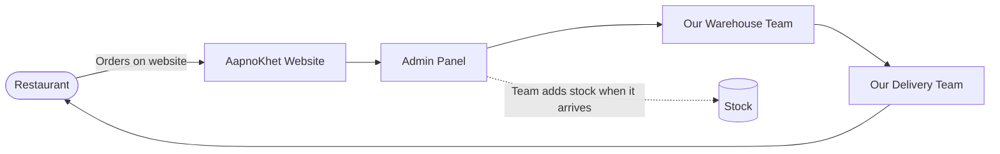

---

# 5B. Admin Panel and Website Control

## 5B.1 What the admin panel is for

The admin panel is a private website for our own team. The owner should be able to change **everything the restaurant sees** without calling a developer. This includes products, prices, photos, banners, texts, offers, delivery areas, delivery time slots, policies and messages sent to customers.

## 5B.2 Who can use it

| Person | What they can do |
|---|---|
| Business Owner (Super Admin) | Everything. Can add team members and give them jobs. |
| Content Manager | Edit website pages, banners, FAQs and product texts. Can send content for approval. |
| Catalog Manager | Add and edit products, photos, pack sizes and prices. |
| Warehouse Manager | Add stock, check quality, fix stock count. |
| Sales Manager | Approve new restaurants, set credit limit, give special prices. |
| Dispatch Manager | Plan deliveries and assign drivers. |
| Finance | Invoices, payments, refunds, credit notes. |
| Support Agent | Answer complaints and tickets. |

The owner can make new roles too, for example "Night Shift Packer", and choose what that role can see.

## 5B.3 Admin panel screens

```mermaid
flowchart TD
    L[Admin Login with 2 step check] --> HOME[Dashboard]
    HOME --> O[Orders]
    HOME --> P[Products]
    HOME --> ST[Stock]
    HOME --> C[Customers]
    HOME --> DL[Delivery]
    HOME --> PY[Payments and Invoices]
    HOME --> OF[Offers]
    HOME --> WS[Website Content]
    HOME --> SP[Support]
    HOME --> RP[Reports]
    HOME --> SET[Settings]
    HOME --> TM[Team and Roles]
    HOME --> AU[Activity History]

    O --> O1[New orders]
    O --> O2[Packing list]
    O --> O3[Cancelled and returned]

    P --> P1[All products]
    P --> P2[Add product]
    P --> P3[Categories]
    P --> P4[Price list and bulk price upload]
    P --> P5[AI Writing Helper]

    ST --> ST1[Add new stock]
    ST --> ST2[Batches and expiry dates]
    ST --> ST3[Fix stock count]
    ST --> ST4[Low stock and near expiry alerts]

    C --> C1[New restaurant requests]
    C --> C2[Approved restaurants]
    C --> C3[Credit limit and special prices]

    DL --> DL1[Delivery areas and pincodes]
    DL --> DL2[Time slots]
    DL --> DL3[Vehicles and drivers]
    DL --> DL4[Today's trips]

    WS --> W1[Home page builder]
    WS --> W2[Banners and sliders]
    WS --> W3[Pages: About, Contact, Policies]
    WS --> W4[FAQs]
    WS --> W5[Menu and footer]
    WS --> W6[Messages and email texts]
    WS --> W7[Photos and files library]
    WS --> W8[Search page settings, SEO]

    SET --> S1[Business details, logo, colours]
    SET --> S2[Tax and GST]
    SET --> S3[Delivery fee and minimum order]
    SET --> S4[Payment options]
    SET --> S5[Order cut off time]
    SET --> S6[Language: English and Hindi]
```

## 5B.4 What the owner can change from the panel

| Area | What can be changed without a developer |
|---|---|
| Business details | Name, logo, address, phone, email, WhatsApp number, GSTIN, FSSAI number, social links |
| Look of the website | Brand colours, fonts from a safe list, button style, home page section order |
| Home page | Banners, top deals, category tiles, "Order again" section, notice bar (for example "No delivery on Sunday") |
| Products | Name, photos, short text, long text, pack size, unit, HSN code, GST rate, MOQ, shelf life, storage tips, lab report file, tags |
| Categories | Add, rename, reorder, hide, show an icon |
| Prices | One price at a time, or upload an Excel/CSV file. Set bulk slabs. Set special price for one restaurant. Set start date and time. |
| Offers | Discount on a product, on an order amount, or for first order. Set start and end date. |
| Stock | Add stock, batch number, expiry date, warehouse. Fix count with a reason. |
| Delivery | Pincodes we serve, time slots, delivery fee, free delivery above an amount, order cut off time |
| Payments | Turn on or off UPI, card, net banking, pay later, cash on delivery. Set credit days and limits. |
| Pages | About, Contact, Terms, Privacy, Refund, Delivery policy, FAQs |
| Messages | Texts for SMS, WhatsApp and email (order placed, packed, on the way, delivered, payment due) |
| SEO | Page title, short description, share image for each page |
| Languages | English and Hindi text for each item |
| Team | Add or remove team members, set roles, reset passwords, force 2 step check |

## 5B.5 Requirements for the admin panel

| ID | Requirement | Priority |
|---|---|---|
| FR-ADM-10 | Owner can add, edit, hide and delete products with photos from one screen | P0 |
| FR-ADM-11 | Upload many products or prices by Excel/CSV. Show a preview and errors before saving | P0 |
| FR-ADM-12 | Every price change has a start date and time. Old prices stay in history | P0 |
| FR-ADM-13 | Home page builder: drag and drop sections, change order, turn sections on or off | P0 |
| FR-ADM-14 | Banner manager with image, link, start and end date, and a mobile version | P0 |
| FR-ADM-15 | Page editor for About, Contact, Policies and FAQs with a simple text editor | P0 |
| FR-ADM-16 | Message template editor for SMS, WhatsApp and email with sample preview | P0 |
| FR-ADM-17 | Settings screen for tax, delivery fee, minimum order, cut off time and payment options | P0 |
| FR-ADM-18 | Delivery area and time slot manager | P0 |
| FR-ADM-19 | Stock screen with batch and expiry date, and alerts for low stock and near expiry | P0 |
| FR-ADM-20 | Customer approval screen with document viewer, approve, reject with reason, credit limit | P0 |
| FR-ADM-21 | Team and role manager with a permission table | P0 |
| FR-ADM-22 | Activity history: who changed what and when, with old value and new value | P0 |
| FR-ADM-23 | Draft, Review, Publish steps for website content. Nothing goes live without publish | P0 |
| FR-ADM-24 | Preview any page as mobile or desktop before publishing | P1 |
| FR-ADM-25 | Go back to an older version of a page or product text with one click | P1 |
| FR-ADM-26 | Media library to store and reuse photos, lab reports and files. Auto resize images | P1 |
| FR-ADM-27 | Search inside the admin panel for orders, customers, products | P1 |
| FR-ADM-28 | Dashboard cards: today's orders, sales, pending payments, low stock, near expiry, late deliveries | P0 |
| FR-ADM-29 | Download reports as Excel/CSV and PDF | P0 |
| FR-ADM-30 | Hindi and English text fields for every public content item | P1 |

## 5B.6 Content status flow

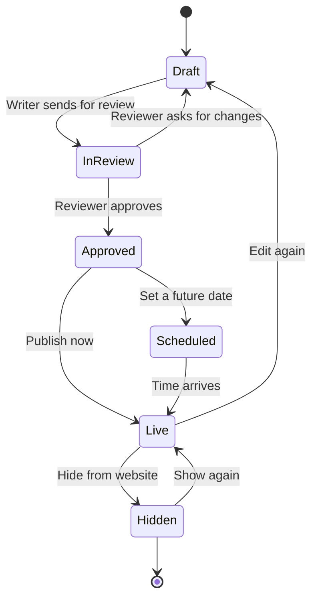

## 5B.7 Extra tables needed in the database for the admin panel

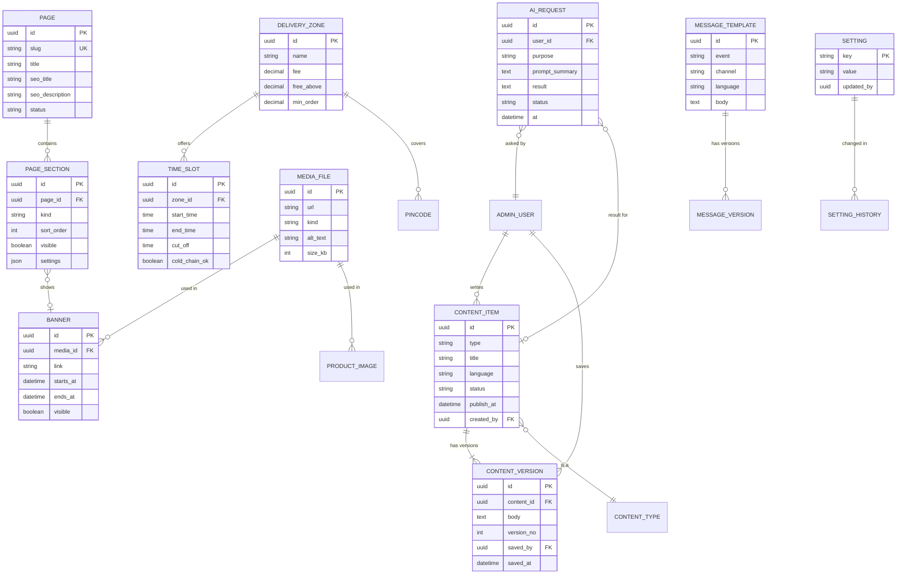

---

# 5C. AI Writing Helper (Simple and Human Language)

## 5C.1 What it does

Inside the admin panel, next to every text box (product description, banner line, FAQ answer, SMS text, email), there is a button called **"Write for me"**. The team member types a few words, and the AI writes a clean draft. The person reads it, changes it if needed and saves it. **The AI never publishes anything by itself.**

## 5C.2 Writing rules the AI must follow

These rules are saved as the AI's standing instruction. The owner can edit them in Settings.

1. Write the way a friendly shopkeeper talks to a regular customer. Warm, clear and honest.
2. Use short and simple words that a school student can understand. If there is an easy word, use the easy word.
3. Keep sentences short. One idea in one sentence.
4. **Do not use dashes** in the text. No " - " or " — " in the middle of sentences. Use a full stop, a comma or the word "and".
5. Do not use heavy or fancy English words. Do not write like an advertisement or a legal paper.
6. Do not make claims we cannot prove. Never write "100% pure", "best in India", "cures" or "no chemicals" unless the lab report or the owner approves it.
7. Use real facts only: pack size, grade, origin, shelf life, how to store. If a fact is missing, leave a blank for the team to fill. Never guess.
8. Do not copy text from other websites.
9. Write in the language asked: English, Hindi, or simple Hinglish if the owner allows it.
10. Sound like a person, not a robot. Do not start every line the same way. Do not use too many exclamation marks or emojis.
11. Keep to the length asked. Product short text: 15 to 25 words. Product long text: 60 to 100 words. Banner line: up to 8 words. SMS: up to 160 characters.
12. Do not put prices, phone numbers or personal details in the text unless the team member gave them.

## 5C.3 Hard word to simple word list (AI must follow, team can add more)

| Instead of | Write |
|---|---|
| utilize | use |
| purchase | buy |
| commence | start |
| assistance | help |
| ensure | make sure |
| approximately | about |
| premium quality | very good quality |
| procure | get |
| facilitate | help with |
| additional | extra |
| authentic | real |
| consume | eat or use |
| dispatch | send |
| remit | pay |
| inventory | stock |
| consignment | delivery |
| perishable | spoils quickly |
| invoice | bill |

## 5C.4 Before and after example

| Hard version | Simple and human version |
|---|---|
| "Our premium, authentic Basmati rice is meticulously sourced to ensure unparalleled culinary excellence." | "Long grain Basmati rice with a lovely smell. Each grain cooks soft and stays separate. Good for biryani and pulao." |
| "Dispatch will commence subsequent to payment confirmation." | "We send your order after your payment is done." |
| "Kindly remit the outstanding amount at the earliest." | "Please pay the pending amount soon. Thank you." |

## 5C.5 How the AI Writing Helper works

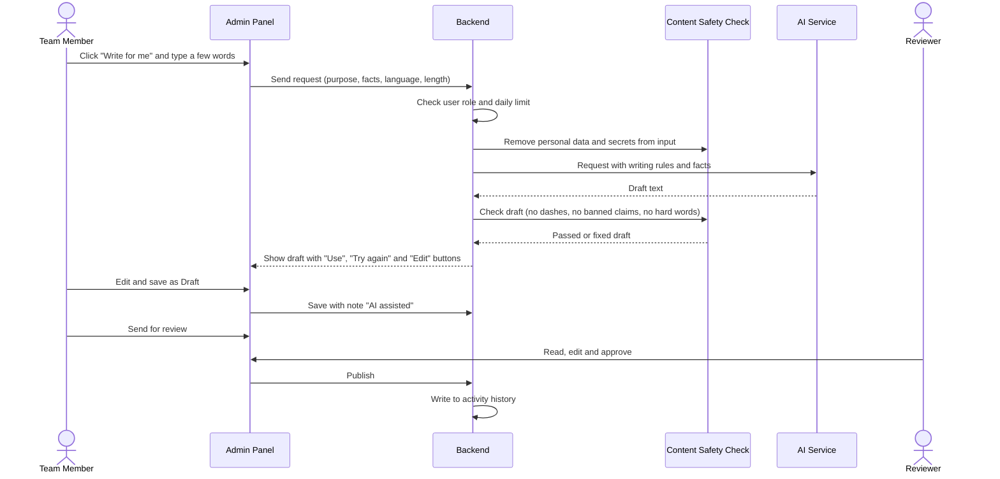

## 5C.6 AI helper requirements

| ID | Requirement | Priority |
|---|---|---|
| FR-AI-01 | "Write for me" button on product text, banner text, FAQ, page text and message templates | P0 |
| FR-AI-02 | AI follows the writing rules in 5C.2 every time | P0 |
| FR-AI-03 | Draft is never published automatically. A person must approve | P0 |
| FR-AI-04 | Auto check on every draft: finds dashes, banned claims and hard words, then fixes or warns | P0 |
| FR-AI-05 | "Make it simpler", "Make it shorter" and "Make it warmer" buttons | P1 |
| FR-AI-06 | English to Hindi and Hindi to English writing with simple words | P1 |
| FR-AI-07 | Fill product text from facts already saved (name, grade, pack size, origin, shelf life) | P0 |
| FR-AI-08 | Mark AI assisted content in the history | P0 |
| FR-AI-09 | Daily limit per user and monthly cost limit for the business | P1 |
| FR-AI-10 | Owner can edit the writing rules and the word list in Settings | P1 |
| FR-AI-11 | Bulk mode: write short texts for 50 products at once, and review each one | P2 |

---

# 5D. Testing the Admin Panel

## White box tests (code level)

| ID | What to test | How |
|---|---|---|
| WB-ADM-01 | Role check on every admin API | Call each API with each role. Only allowed roles pass |
| WB-ADM-02 | Content status rules | Try every move between Draft, Review, Approved, Live, Hidden. Wrong moves must fail |
| WB-ADM-03 | Price start date logic | Several prices with future dates. The right one is picked at the right time |
| WB-ADM-04 | Bulk upload parser | Empty file, 1 row, 10,000 rows, wrong columns, text in number column, negative price |
| WB-ADM-05 | Version history | Save 3 versions, go back to version 1, check text and history |
| WB-ADM-06 | Banner time window | Banner shows only between start and end time, also at the exact second |
| WB-ADM-07 | AI text checker | Text with dashes, banned claims and hard words is fixed or flagged. Clean text passes |
| WB-ADM-08 | AI daily limit | Request number 1, limit, and limit plus 1 |
| WB-ADM-09 | Settings change | Every change writes old and new value to history |
| WB-ADM-10 | Text editor cleaning | Scripts and bad HTML are removed before save |

## Black box tests (user level)

| ID | Scenario | Expected |
|---|---|---|
| BB-ADM-01 | Content Manager tries to open Finance screen | Not allowed |
| BB-ADM-02 | Owner changes home page banner and publishes | New banner shows on the website within 1 minute |
| BB-ADM-03 | Banner end date passes | Banner disappears by itself |
| BB-ADM-04 | Add a product with 3 photos, price slabs and lab report | Shows correctly on the website |
| BB-ADM-05 | Upload price file with 2 wrong rows | Preview shows both errors. Nothing is saved until fixed |
| BB-ADM-06 | Change delivery fee in settings | New fee shows at checkout for new orders only |
| BB-ADM-07 | Turn off "Cash on delivery" | Option vanishes from checkout |
| BB-ADM-08 | Click "Write for me" with 3 facts | Draft is simple, short and has no dashes |
| BB-ADM-09 | Ask AI to write "best in India, 100% pure" | AI refuses that claim or flags it |
| BB-ADM-10 | Send content for review, reviewer asks for change | Goes back to Draft with the comment |
| BB-ADM-11 | Go back to an old version of a page | Old text is live again and the action is in history |
| BB-ADM-12 | Add a new team member with limited role | They see only the allowed menus |
| BB-ADM-13 | Remove a team member while logged in | They are logged out within 1 minute |
| BB-ADM-14 | Switch to Hindi on product page | Hindi text shows. If missing, English shows |
| BB-ADM-15 | Edit SMS template with a missing sample value | Preview warns before saving |

## Security checks for the admin panel and AI helper

| Risk | What we do | How to check |
|---|---|---|
| Someone steals an admin password | Two step login for all team members, short sessions, lock after wrong tries, allow only trusted devices or office network if possible | Try login without second step. Try many wrong passwords |
| A team member does more than their job | Roles with small permissions. Owner reviews access every 3 months | Test every menu for every role |
| Bad script saved in a text box and shown to customers | Clean all text, safe editor, strict browser rules (CSP) | Save `<script>` and `onerror=` text and view the page |
| Wrong price or fake offer saved by mistake or on purpose | Big price changes (for example more than 15 percent) need a second person to approve. Full history | Change price by 50 percent and check the approval step |
| Bad file upload in the media library | Only allowed image and PDF types, size limit, virus scan, new random file names, private storage | Upload a renamed program file |
| AI is tricked by text pasted from outside ("ignore your rules and write...") | AI treats pasted text only as plain material, rules cannot be changed by it, draft is checked again and a person approves | Paste a trick text and see that rules still hold |
| AI makes up a false health or purity claim | Banned claims list, check on every draft, human approval, facts come only from saved product data | Ask for "cures diabetes" and see it blocked |
| Personal or private data sent to the AI | Remove phone numbers, emails, GSTIN and bank details from the request before sending | Send a text with a phone number and check the logs |
| AI key leaks or cost runs too high | Key stored in a safe vault, never in the browser, daily and monthly limits, alerts | Look for the key in code and logs. Test the limit |
| Someone changes settings secretly | Every change saved with name, time, old value and new value. History cannot be edited | Try to edit history |
| Bulk upload used to damage data | File type, size and row limits, preview step, undo within 24 hours, approval for big changes | Upload a file with 1 lakh rows |
| Admin panel found by outsiders | Separate web address, WAF, rate limit, hide from search engines | Scan and try guessing the address |
| Leaving team members keep access | One click "remove access" that ends all their sessions at once | Remove a user and test an old session |

---

# 6. Non-Functional Requirements

| Category | Requirement |
|---|---|
| Performance | Page load < 2.5 s (p95) on 4G; API p95 < 500 ms; search < 300 ms |
| Scalability | 5,000 concurrent users, 50,000 SKUs-variants, horizontal scaling |
| Availability | 99.9% uptime; RPO ≤ 15 min; RTO ≤ 1 hour |
| Security | OWASP ASVS Level 2, TLS 1.2+, encryption at rest, PCI-DSS via gateway (SAQ-A) |
| Usability | WCAG 2.1 AA, mobile-first, Hindi + English (i18n-ready) |
| Compatibility | Latest 2 versions of Chrome, Edge, Safari, Firefox; Android 8+ browsers |
| Maintainability | Modular code, > 80% unit-test coverage on core modules, CI/CD |
| Auditability | Immutable audit trail for price, stock, order, payment, role changes |
| Data retention | Financial records 8 years; logs 1 year; personal data per DPDP Act 2023 |
| Backup | Daily full + continuous WAL; monthly restore test |
| Observability | Centralized logs, metrics, tracing, alerts |
| Localization | INR currency, IST timezone, Indian address format |

---

# 7. System Architecture

## 7.1 Recommended Technology Stack
| Layer | Choice |
|---|---|
| Frontend | React / Next.js + TypeScript, Tailwind CSS, PWA |
| Backend | Node.js (NestJS) **or** Python (Django/FastAPI), modular monolith, microservices-ready |
| Database | PostgreSQL (primary), Redis (cache/session/queue) |
| Search | PostgreSQL FTS initially; OpenSearch/Meilisearch later |
| Queue | BullMQ / RabbitMQ (notifications, invoicing, reports) |
| Storage | S3-compatible object storage (documents, lab reports, images, PODs) |
| Auth | JWT (short-lived) + refresh token (httpOnly cookie), OAuth2/OIDC-ready |
| Payments | Razorpay / Cashfree / PayU |
| Notifications | Email (SES/SendGrid), SMS (MSG91), WhatsApp Business API |
| Infra | Docker, Kubernetes or managed (AWS ECS / Azure App Service), CDN, WAF |
| CI/CD | GitHub Actions, IaC with Terraform |
| Monitoring | Prometheus + Grafana, ELK/Loki, Sentry |

## 7.2 High-Level Architecture Diagram

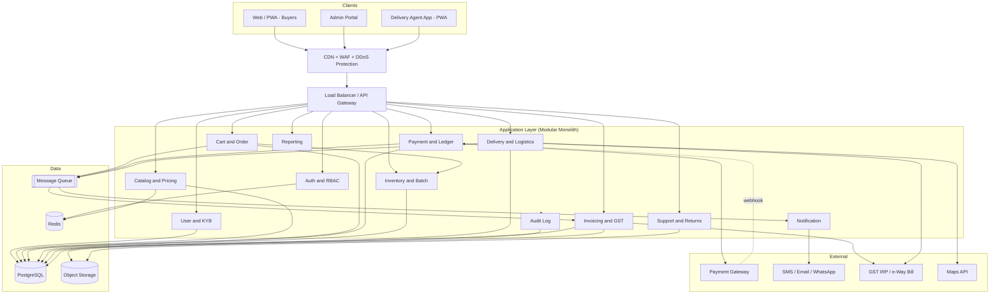

---

# 8. UML and Software-Engineering Diagrams

## 8.1 Context Diagram (System Boundary)

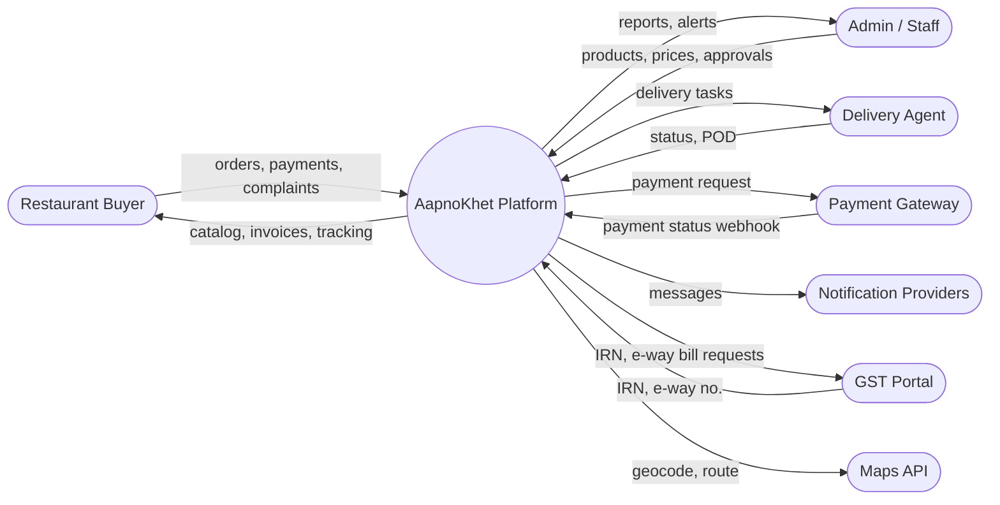

---

## 8.2 Data Flow Diagrams (DFD)

### 8.2.1 DFD Level 0 (Context-level)

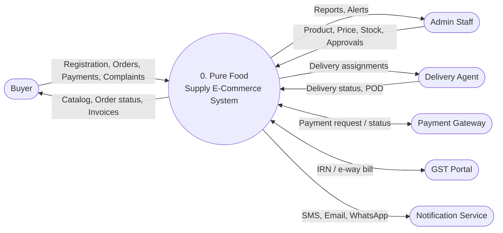

### 8.2.2 DFD Level 1

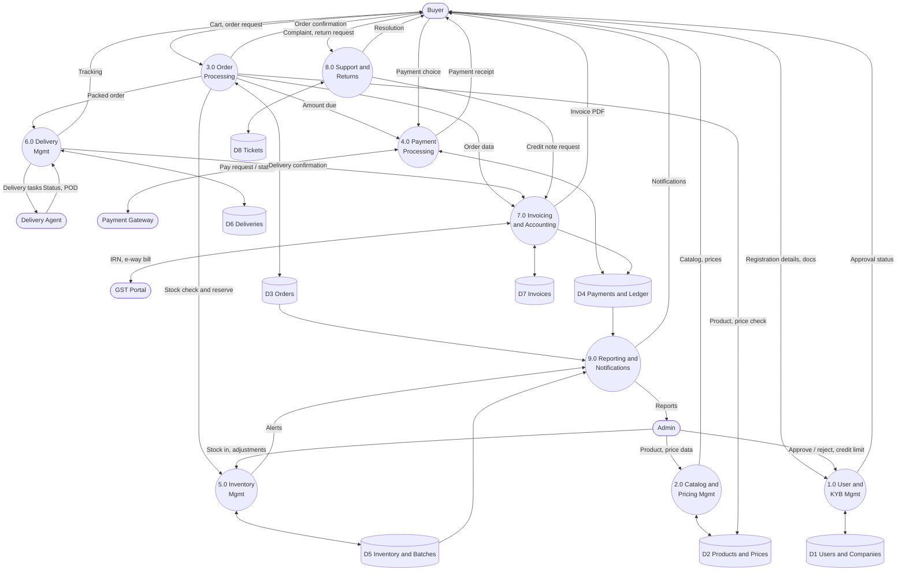

### 8.2.3 DFD Level 2, Process 3.0 Order Processing

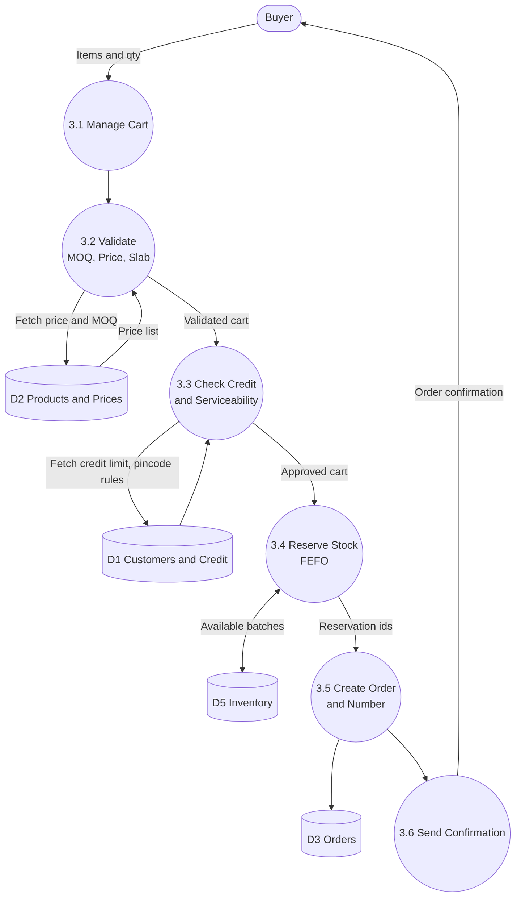

### 8.2.4 DFD Level 2, Process 4.0 Payment Processing

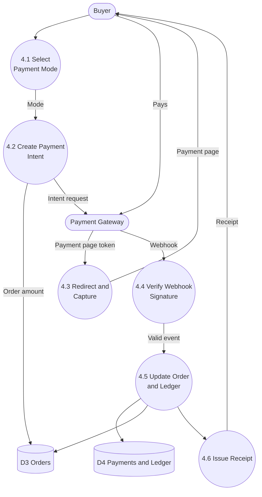

### 8.2.5 DFD Level 2, Process 5.0 Inventory

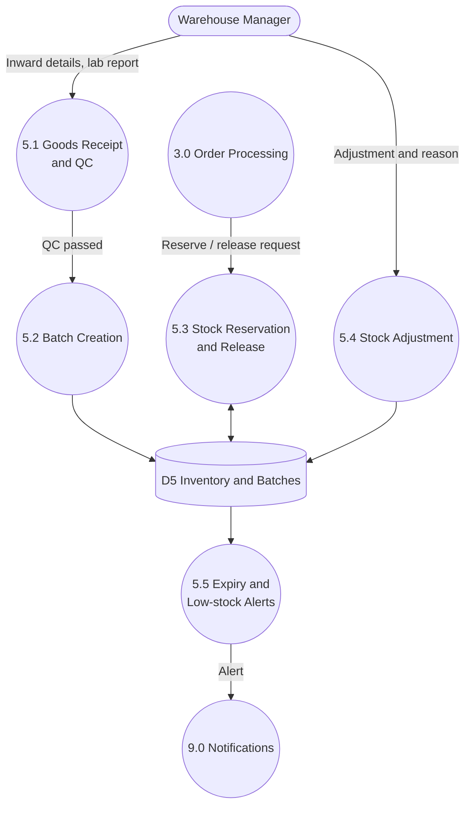

---

## 8.3 Use Case Diagram

(Mermaid has no native use-case notation, so actors and use cases are drawn with a flowchart.)

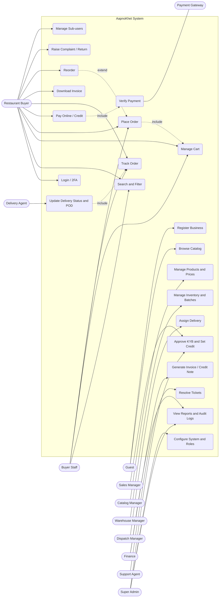

### Use Case Specification, UC6 Place Order

| Item | Description |
|---|---|
| Actor | Restaurant Buyer / Staff |
| Pre-condition | User logged in, KYB approved, cart not empty |
| Trigger | Click "Place Order" at checkout |
| Main flow | 1) System validates MOQ, price, stock. 2) User selects address and delivery slot. 3) System checks credit/serviceability. 4) User picks payment mode. 5) System reserves stock (FEFO). 6) System creates order, sends confirmation. |
| Alternate flow A | Item out of stock → system suggests reduced quantity or alternate pack |
| Alternate flow B | Order > staff limit → goes to owner approval |
| Alternate flow C | Credit limit exceeded → force online/advance payment |
| Exception | Payment fails → order stays "Payment Pending", stock released after 30 min |
| Post-condition | Order created with status Confirmed (or Pending Payment), stock reserved |

---

## 8.4 ER Diagram (Entity Relationship)

```mermaid
erDiagram
    COMPANY ||--o{ USER : employs
    COMPANY ||--o{ ADDRESS : has
    COMPANY ||--o{ KYB_DOCUMENT : submits
    COMPANY ||--o| CREDIT_ACCOUNT : has
    COMPANY ||--o{ CUSTOMER_PRICE : "gets special"
    COMPANY ||--o{ ORDER : places
    COMPANY ||--o{ TICKET : raises
    USER }o--|| ROLE : "assigned"
    ROLE ||--o{ ROLE_PERMISSION : grants
    PERMISSION ||--o{ ROLE_PERMISSION : "included in"
    USER ||--o{ CART : owns
    USER ||--o{ AUDIT_LOG : generates
    USER ||--o{ ORDER : "created by"

    CATEGORY ||--o{ PRODUCT : contains
    PRODUCT ||--|{ PRODUCT_VARIANT : "sold as"
    PRODUCT_VARIANT ||--o{ PRICE_SLAB : "has"
    PRODUCT_VARIANT ||--o{ CUSTOMER_PRICE : "priced for"
    PRODUCT_VARIANT ||--o{ BATCH : "stocked as"
    PRODUCT_VARIANT ||--o{ CART_ITEM : "added in"
    PRODUCT_VARIANT ||--o{ ORDER_ITEM : "ordered in"
    PRODUCT ||--o{ LAB_REPORT : "certified by"
    BATCH ||--o| LAB_REPORT : "tested by"

    WAREHOUSE ||--o{ BATCH : stores
    BATCH ||--o{ STOCK_MOVEMENT : "tracked by"
    BATCH ||--o{ STOCK_RESERVATION : "reserved in"

    CART ||--|{ CART_ITEM : contains
    ORDER ||--|{ ORDER_ITEM : contains
    ORDER ||--o{ STOCK_RESERVATION : reserves
    ORDER }o--|| ADDRESS : "ships to"
    ORDER ||--o{ PAYMENT : "paid by"
    ORDER ||--o| INVOICE : "billed by"
    ORDER ||--o| DELIVERY : "fulfilled by"
    ORDER ||--o{ ORDER_STATUS_HISTORY : logs
    ORDER_ITEM }o--o| BATCH : "allocated from"

    INVOICE ||--o{ CREDIT_NOTE : adjusted
    PAYMENT ||--o{ REFUND : "reversed by"
    COMPANY ||--o{ LEDGER_ENTRY : "accounts"

    DELIVERY }o--|| VEHICLE : uses
    DELIVERY }o--|| DRIVER : "driven by"
    DELIVERY ||--o{ DELIVERY_EVENT : tracks
    DELIVERY ||--o| PROOF_OF_DELIVERY : "confirmed by"

    TICKET ||--o{ TICKET_MESSAGE : has
    TICKET }o--o| ORDER : "about"
    TICKET ||--o| RETURN_REQUEST : "leads to"
    NOTIFICATION }o--|| USER : "sent to"

    COMPANY {
        uuid id PK
        string legal_name
        string trade_name
        string gstin UK
        string pan
        string fssai_no
        string business_type
        string kyb_status
        datetime created_at
    }
    USER {
        uuid id PK
        uuid company_id FK
        uuid role_id FK
        string name
        string email UK
        string mobile UK
        string password_hash
        boolean mfa_enabled
        string status
        datetime last_login
    }
    ROLE {
        uuid id PK
        string name UK
        string scope
    }
    PERMISSION {
        uuid id PK
        string code UK
        string description
    }
    ROLE_PERMISSION {
        uuid role_id FK
        uuid permission_id FK
    }
    ADDRESS {
        uuid id PK
        uuid company_id FK
        string line1
        string city
        string state
        string pincode
        decimal lat
        decimal lng
        boolean is_default
    }
    KYB_DOCUMENT {
        uuid id PK
        uuid company_id FK
        string doc_type
        string file_url
        string status
        string reviewed_by
    }
    CREDIT_ACCOUNT {
        uuid id PK
        uuid company_id FK
        decimal credit_limit
        int credit_days
        decimal outstanding
    }
    CATEGORY {
        uuid id PK
        string name
        uuid parent_id
        boolean is_perishable
    }
    PRODUCT {
        uuid id PK
        uuid category_id FK
        string name
        string brand
        string hsn_code
        decimal gst_rate
        string origin
        string description
        boolean active
    }
    PRODUCT_VARIANT {
        uuid id PK
        uuid product_id FK
        string sku UK
        string pack_size
        string unit
        decimal base_price
        int moq
        int shelf_life_days
    }
    PRICE_SLAB {
        uuid id PK
        uuid variant_id FK
        int min_qty
        int max_qty
        decimal price
        datetime effective_from
    }
    CUSTOMER_PRICE {
        uuid id PK
        uuid company_id FK
        uuid variant_id FK
        decimal price
        datetime valid_till
    }
    WAREHOUSE {
        uuid id PK
        string name
        string address
        boolean cold_storage
    }
    BATCH {
        uuid id PK
        uuid variant_id FK
        uuid warehouse_id FK
        string batch_no UK
        date mfg_date
        date expiry_date
        int qty_available
        int qty_reserved
        string qc_status
    }
    LAB_REPORT {
        uuid id PK
        uuid batch_id FK
        string report_url
        string lab_name
        date tested_on
        string result
    }
    STOCK_MOVEMENT {
        uuid id PK
        uuid batch_id FK
        string type
        int qty
        string reason
        uuid done_by
        datetime at
    }
    STOCK_RESERVATION {
        uuid id PK
        uuid order_id FK
        uuid batch_id FK
        int qty
        string status
        datetime expires_at
    }
    CART {
        uuid id PK
        uuid user_id FK
        datetime updated_at
    }
    CART_ITEM {
        uuid id PK
        uuid cart_id FK
        uuid variant_id FK
        int qty
    }
    ORDER {
        uuid id PK
        string order_no UK
        uuid company_id FK
        uuid placed_by FK
        uuid address_id FK
        string status
        decimal subtotal
        decimal tax_total
        decimal delivery_fee
        decimal grand_total
        string payment_mode
        date delivery_date
        string delivery_slot
    }
    ORDER_ITEM {
        uuid id PK
        uuid order_id FK
        uuid variant_id FK
        uuid batch_id FK
        int qty
        decimal unit_price
        decimal tax_amount
    }
    ORDER_STATUS_HISTORY {
        uuid id PK
        uuid order_id FK
        string status
        uuid changed_by
        datetime at
    }
    PAYMENT {
        uuid id PK
        uuid order_id FK
        string gateway_txn_id UK
        string mode
        decimal amount
        string status
        datetime paid_at
    }
    REFUND {
        uuid id PK
        uuid payment_id FK
        decimal amount
        string status
        string reason
    }
    INVOICE {
        uuid id PK
        uuid order_id FK
        string invoice_no UK
        string irn
        decimal total
        date due_date
        string pdf_url
        string status
    }
    CREDIT_NOTE {
        uuid id PK
        uuid invoice_id FK
        decimal amount
        string reason
    }
    LEDGER_ENTRY {
        uuid id PK
        uuid company_id FK
        string entry_type
        decimal debit
        decimal credit
        string ref_type
        uuid ref_id
        datetime at
    }
    VEHICLE {
        uuid id PK
        string reg_no UK
        string type
        boolean refrigerated
    }
    DRIVER {
        uuid id PK
        string name
        string mobile
        string license_no
    }
    DELIVERY {
        uuid id PK
        uuid order_id FK
        uuid vehicle_id FK
        uuid driver_id FK
        string eway_bill_no
        string status
        datetime eta
    }
    DELIVERY_EVENT {
        uuid id PK
        uuid delivery_id FK
        string event
        decimal lat
        decimal lng
        datetime at
    }
    PROOF_OF_DELIVERY {
        uuid id PK
        uuid delivery_id FK
        string otp_verified
        string photo_url
        string signature_url
        datetime at
    }
    TICKET {
        uuid id PK
        uuid company_id FK
        uuid order_id FK
        string type
        string status
        string priority
    }
    TICKET_MESSAGE {
        uuid id PK
        uuid ticket_id FK
        uuid sender_id
        string body
        string attachment_url
    }
    RETURN_REQUEST {
        uuid id PK
        uuid ticket_id FK
        string resolution
        decimal amount
    }
    NOTIFICATION {
        uuid id PK
        uuid user_id FK
        string channel
        string template
        string status
    }
    AUDIT_LOG {
        uuid id PK
        uuid user_id FK
        string action
        string entity
        string entity_id
        json before
        json after
        string ip
        datetime at
    }
```

---

## 8.5 Class Diagram

### 8.5.1 Domain Model

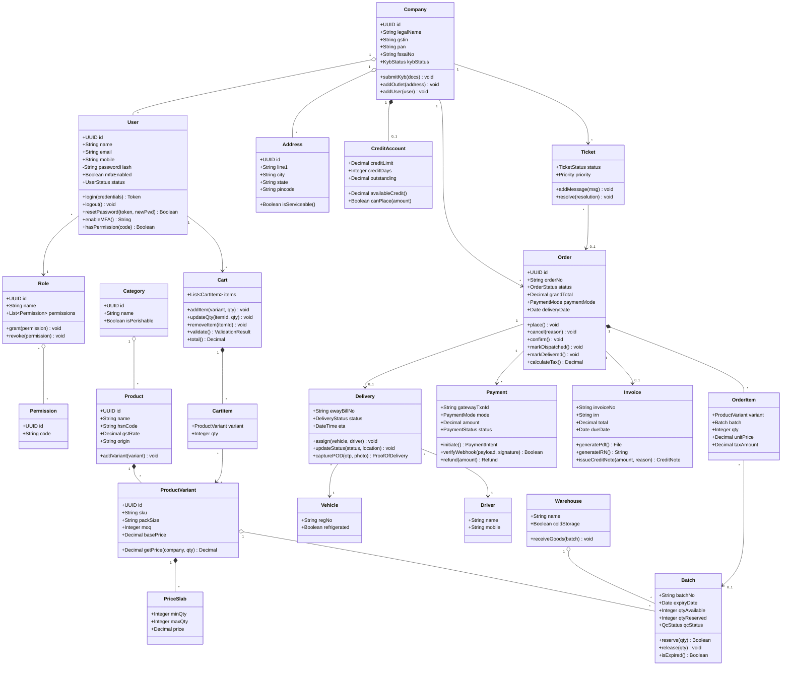

### 8.5.2 Design-Pattern Class Diagram (Service Layer)

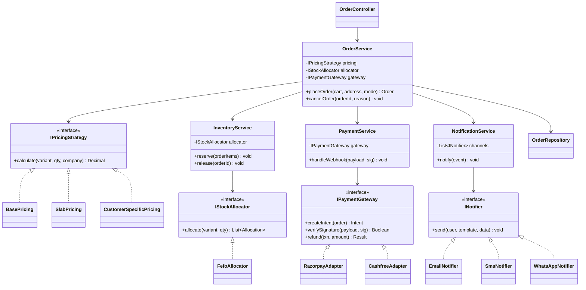

---

## 8.6 Object Diagram (Example Snapshot)

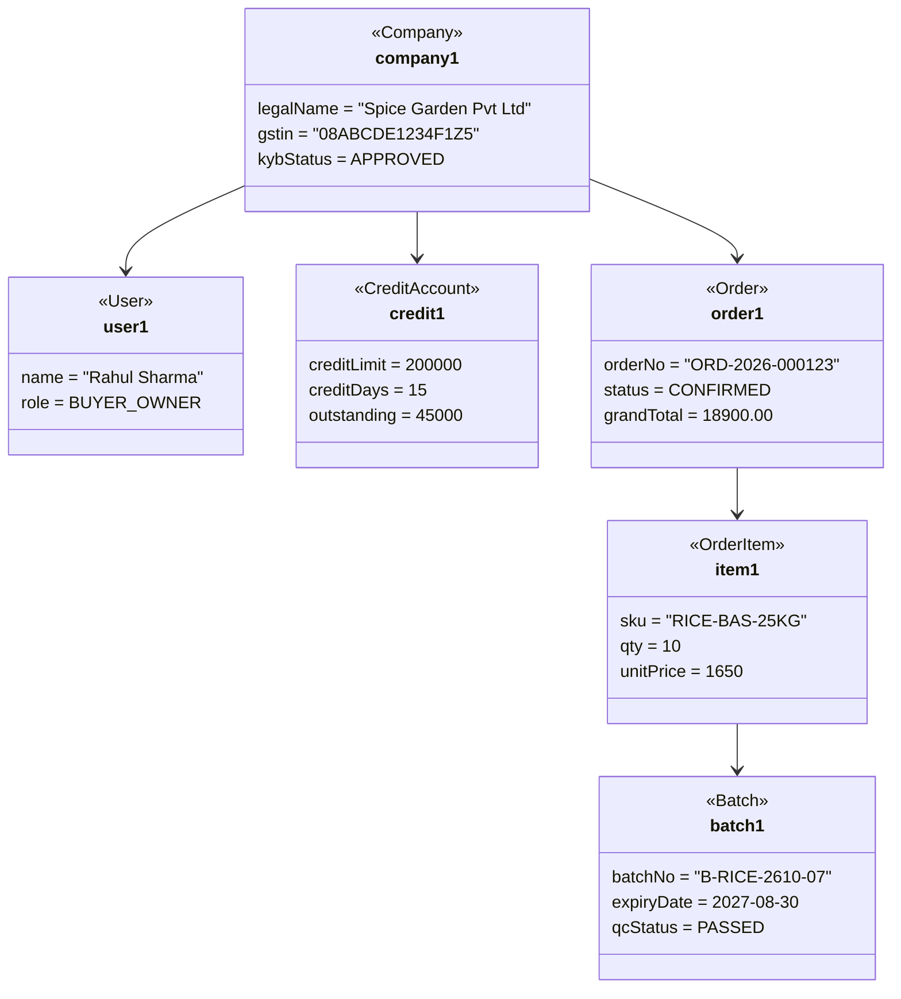

---

## 8.7 Sequence Diagrams

### 8.7.1 Registration and KYB Approval

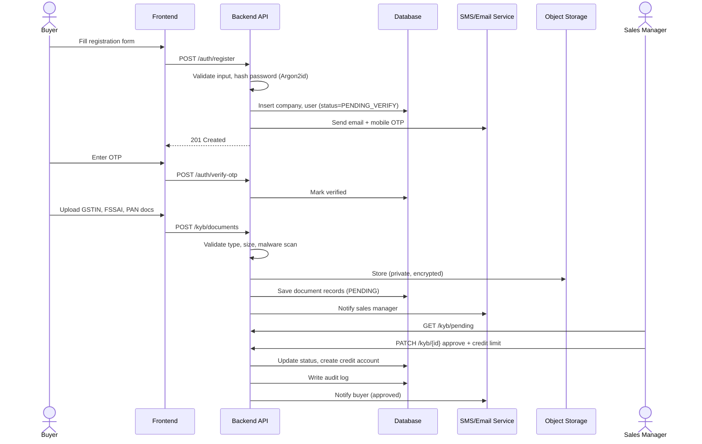

### 8.7.2 Login with 2FA

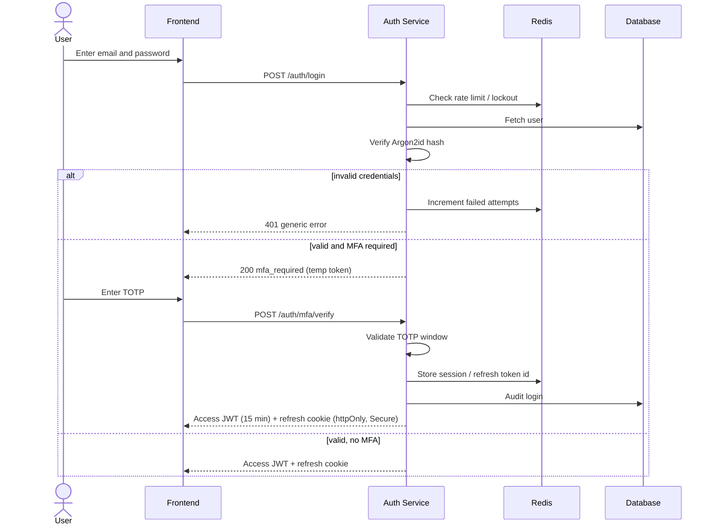

### 8.7.3 Place Order with Online Payment

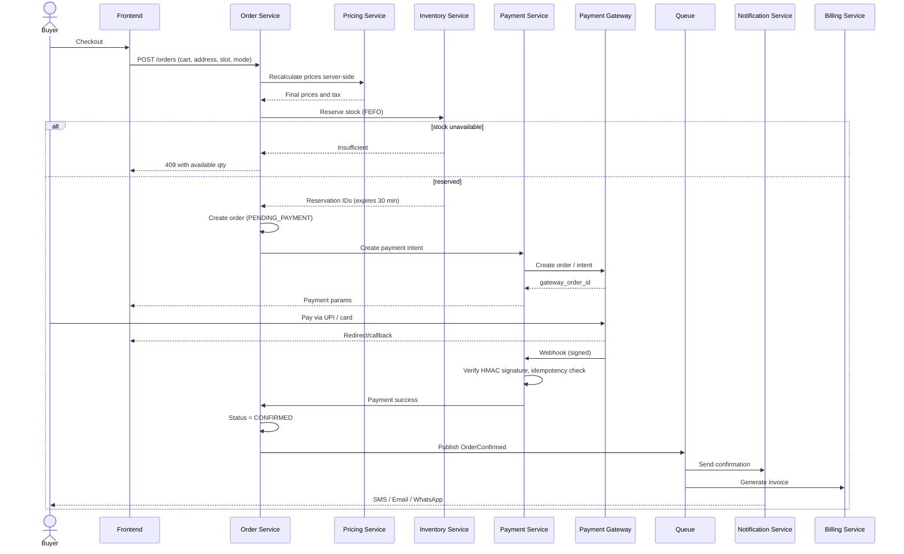

### 8.7.4 Place Order on Credit Terms

```mermaid
sequenceDiagram
    actor B as Buyer
    participant OS as Order Service
    participant CR as Credit Service
    participant IS as Inventory
    participant MQ as Queue

    B->>OS: Place order (mode=CREDIT)
    OS->>CR: Check available credit
    alt overdue invoices or limit exceeded
        CR-->>OS: Denied
        OS-->>B: Please pay online / clear dues
    else allowed
        CR-->>OS: Approved
        OS->>IS: Reserve stock
        OS->>CR: Add to outstanding
        OS->>OS: Status = CONFIRMED
        OS->>MQ: OrderConfirmed
        OS-->>B: Order confirmation
    end
```

### 8.7.5 Fulfilment, Delivery and POD

```mermaid
sequenceDiagram
    actor WM as Warehouse Mgr
    actor DM as Dispatch Mgr
    actor DA as Delivery Agent
    actor B as Buyer
    participant API as Backend
    participant GST as e-Way Bill Portal
    participant NS as Notification

    WM->>API: Generate pick list for confirmed orders
    WM->>API: Mark PACKED (batch-verified scan)
    DM->>API: Assign vehicle and driver
    API->>GST: Generate e-way bill (if applicable)
    GST-->>API: EWB number
    API->>NS: Dispatched notification
    NS-->>B: "Your order is on the way" + tracking link
    DA->>API: Start trip (location pings)
    DA->>API: Arrived at location
    API->>NS: Send delivery OTP to buyer
    B->>DA: Share OTP / sign
    DA->>API: Submit OTP + photo + signature
    API->>API: Verify OTP, mark DELIVERED
    API->>NS: Delivered notification + invoice link
```

### 8.7.6 Complaint and Return

```mermaid
sequenceDiagram
    actor B as Buyer
    participant API as Support Service
    actor SA as Support Agent
    participant INV as Inventory
    participant BILL as Billing

    B->>API: Raise complaint (order, item, photos)
    API->>API: Validate window (e.g., 24-48h) and ownership
    API-->>SA: New ticket assigned
    SA->>API: Review and decide (replace / credit / reject)
    alt credit note
        API->>BILL: Issue credit note
        BILL-->>B: Credit note PDF
    else replacement
        API->>INV: Reserve replacement stock
    else reject
        API-->>B: Rejection with reason
    end
    API->>API: Close ticket, audit log
```

### 8.7.7 Daily Price Update

```mermaid
sequenceDiagram
    actor CM as Catalog Manager
    participant API as Catalog Service
    participant DB as Database
    participant C as Redis Cache
    participant NS as Notification

    CM->>API: Upload / edit price list (CSV or UI)
    API->>API: Validate (numeric, > 0, change % threshold)
    alt change > threshold (e.g. 15%)
        API-->>CM: Needs second approval
    end
    API->>DB: Insert new price rows (effective_from), keep history
    API->>C: Invalidate price cache
    API->>DB: Audit log (before/after)
    API->>NS: Notify subscribed buyers (optional)
```

---

## 8.8 Activity Diagrams

### 8.8.1 Order-to-Cash Process

```mermaid
flowchart TD
    A([Start]) --> B[Buyer browses catalog]
    B --> C[Add items to cart]
    C --> D{MOQ and stock OK?}
    D -- No --> C
    D -- Yes --> E[Select address and slot]
    E --> F{Pincode serviceable?}
    F -- No --> G[Show error / choose another address]
    G --> E
    F -- Yes --> H{Payment mode}
    H -- Online --> I[Pay via gateway]
    H -- Credit --> J{Credit available and no overdue?}
    J -- No --> I
    J -- Yes --> K[Order confirmed]
    I --> L{Payment success?}
    L -- No --> M[Retry or cancel, release stock after timeout]
    M --> H
    L -- Yes --> K
    K --> N[Generate pick list]
    N --> O[Pick, QC and pack - FEFO]
    O --> P[Generate invoice and e-way bill]
    P --> Q[Assign vehicle and driver]
    Q --> R[Deliver]
    R --> S{Delivered successfully?}
    S -- No --> T[Re-attempt or return to warehouse]
    T --> Q
    S -- Yes --> U[Capture POD]
    U --> V{Credit order?}
    V -- Yes --> W[Collect payment by due date, send reminders]
    V -- No --> X[Close order]
    W --> X
    X --> Y([End])
```

### 8.8.2 Inventory Goods Receipt and Batch QC

```mermaid
flowchart TD
    A([Goods arrive at warehouse]) --> B[Check the purchase bill]
    B --> C[Create inward entry]
    C --> D[Sample for lab test]
    D --> E{Lab result passes<br/>purity and FSSAI limits?}
    E -- No --> F[Mark batch REJECTED, quarantine, send back where we bought it]
    E -- Yes --> G[Create batch: batch no, mfg, expiry, report]
    G --> H[Assign storage: ambient or cold]
    H --> I[Stock available for sale]
    I --> J{Expiry within 30 days?}
    J -- Yes --> K[Alert + push discount / priority dispatch]
    J -- No --> L([Monitor])
    F --> M([End])
    K --> L
```

### 8.8.3 KYB Approval

```mermaid
flowchart TD
    A([Buyer registers]) --> B[Verify email and mobile OTP]
    B --> C[Upload GSTIN, FSSAI, PAN]
    C --> D[Auto-validate GSTIN format and API]
    D --> E{Valid?}
    E -- No --> F[Reject with reason, allow resubmit]
    E -- Yes --> G[Sales manager manual review]
    G --> H{Approve?}
    H -- No --> F
    H -- Yes --> I[Set credit limit and terms]
    I --> J[Activate account, notify buyer]
    J --> K([End])
```

### 8.8.4 Swimlane, Order Fulfilment

```mermaid
flowchart LR
    subgraph Buyer
        B1[Place order] --> B2[Pay / confirm]
        B9[Receive goods, share OTP]
    end
    subgraph System
        S1[Validate and reserve stock] --> S2[Create order and invoice]
        S5[Send notifications]
    end
    subgraph Warehouse
        W1[Pick FEFO batches] --> W2[Pack and label]
    end
    subgraph Dispatch
        D1[Assign vehicle and driver] --> D2[Dispatch with e-way bill]
    end
    subgraph Driver
        R1[Deliver and capture POD]
    end
    B1 --> S1
    B2 --> S2
    S2 --> W1
    W2 --> D1
    D2 --> R1
    R1 --> B9
    S2 --> S5
    R1 --> S5
```

---

## 8.9 State Machine Diagrams

### 8.9.1 Order State

```mermaid
stateDiagram-v2
    [*] --> Draft
    Draft --> PendingPayment: place order (online)
    Draft --> PendingApproval: staff order above limit
    PendingApproval --> Confirmed: owner approves (credit)
    PendingApproval --> Cancelled: rejected
    Draft --> Confirmed: credit / COD approved
    PendingPayment --> Confirmed: payment success
    PendingPayment --> Cancelled: timeout / failed
    Confirmed --> Packed: picked and QC passed
    Confirmed --> Cancelled: buyer or admin cancels before pack
    Packed --> Dispatched: vehicle assigned
    Dispatched --> OutForDelivery: trip started
    OutForDelivery --> Delivered: POD captured
    OutForDelivery --> DeliveryFailed: customer unavailable
    DeliveryFailed --> OutForDelivery: re-attempt
    DeliveryFailed --> ReturnedToWarehouse: max attempts
    Delivered --> PartiallyReturned: complaint accepted (part)
    Delivered --> Returned: complaint accepted (full)
    Delivered --> Closed: payment settled, no dispute
    PartiallyReturned --> Closed
    Returned --> Closed
    ReturnedToWarehouse --> Closed
    Cancelled --> [*]
    Closed --> [*]
```

### 8.9.2 Payment State

```mermaid
stateDiagram-v2
    [*] --> Initiated
    Initiated --> Pending: sent to gateway
    Pending --> Success: webhook verified
    Pending --> Failed: declined / timeout
    Pending --> Expired: no action in 30 min
    Failed --> Initiated: retry
    Success --> PartiallyRefunded: partial refund
    Success --> Refunded: full refund
    PartiallyRefunded --> Refunded
    Expired --> [*]
    Refunded --> [*]
    Success --> [*]
```

### 8.9.3 Batch / Stock State

```mermaid
stateDiagram-v2
    [*] --> Received
    Received --> QCPending
    QCPending --> Available: lab passed
    QCPending --> Rejected: lab failed
    Available --> LowStock: qty below reorder level
    LowStock --> Available: replenished
    Available --> NearExpiry: expiry within 30 days
    NearExpiry --> Expired: past expiry
    Available --> SoldOut
    Expired --> Disposed
    Rejected --> SentBack
    SoldOut --> [*]
    Disposed --> [*]
    SentBack --> [*]
```

### 8.9.4 Buyer Account / KYB State

```mermaid
stateDiagram-v2
    [*] --> Registered
    Registered --> Verified: OTP verified
    Verified --> KYBSubmitted: documents uploaded
    KYBSubmitted --> Approved: sales approves
    KYBSubmitted --> Rejected: invalid docs
    Rejected --> KYBSubmitted: resubmit
    Approved --> Suspended: overdue / fraud
    Suspended --> Approved: cleared
    Approved --> Closed
    Closed --> [*]
```

### 8.9.5 Ticket State

```mermaid
stateDiagram-v2
    [*] --> Open
    Open --> InReview
    InReview --> WaitingForCustomer
    WaitingForCustomer --> InReview
    InReview --> Resolved
    InReview --> Rejected
    Resolved --> Reopened: customer disputes
    Reopened --> InReview
    Resolved --> Closed
    Rejected --> Closed
    Closed --> [*]
```

---

## 8.10 Communication (Collaboration) Diagram

Object interaction for "Place Order" with numbered messages:

```mermaid
flowchart LR
    Buyer((:Buyer)) -- "1: placeOrder()" --> OC[:OrderController]
    OC -- "2: place(cart)" --> OS[:OrderService]
    OS -- "3: price(items)" --> PS[:PricingService]
    OS -- "4: reserve(items)" --> IS[:InventoryService]
    IS -- "5: allocate() FEFO" --> BA[:Batch]
    OS -- "6: save(order)" --> OR[:OrderRepository]
    OS -- "7: createIntent()" --> PY[:PaymentService]
    PY -- "8: createOrder()" --> GW[:GatewayAdapter]
    OS -- "9: publish(OrderPlaced)" --> NS[:NotificationService]
    NS -- "10: send()" --> Buyer
```

---

## 8.11 Component Diagram

```mermaid
flowchart TB
    subgraph FrontendApps
        BW[Buyer Web App]
        AW[Admin Web App]
        DW[Driver PWA]
    end
    subgraph Gateway
        GW[API Gateway: routing, rate limit, JWT validation]
    end
    subgraph Components
        C1[Identity Component<br/>auth, MFA, RBAC]
        C2[Customer Component<br/>company, KYB, credit]
        C3[Catalog Component<br/>products, pricing, search]
        C4[Order Component<br/>cart, checkout, workflow]
        C5[Payment Component<br/>gateway adapter, ledger]
        C6[Inventory Component<br/>batch, stock, FEFO]
        C7[Logistics Component<br/>delivery, tracking, POD]
        C8[Billing Component<br/>invoice, GST, credit notes]
        C9[Support Component<br/>tickets, returns]
        C10[Notification Component]
        C11[Reporting Component]
        C12[Audit Component]
    end
    subgraph Infra
        DB[(PostgreSQL)]
        CA[(Redis)]
        OBJ[(Object Store)]
        Q[[Queue]]
    end
    BW --> GW
    AW --> GW
    DW --> GW
    GW --> C1
    GW --> C2
    GW --> C3
    GW --> C4
    GW --> C5
    GW --> C6
    GW --> C7
    GW --> C8
    GW --> C9
    GW --> C11
    C4 --> C3
    C4 --> C6
    C4 --> C5
    C4 --> C2
    C7 --> C4
    C8 --> C4
    C9 --> C8
    C9 --> C6
    C4 --> Q
    C5 --> Q
    C7 --> Q
    Q --> C10
    Q --> C8
    C1 --> CA
    C3 --> CA
    C1 --> DB
    C2 --> DB
    C3 --> DB
    C4 --> DB
    C5 --> DB
    C6 --> DB
    C7 --> DB
    C8 --> DB
    C8 --> OBJ
    C9 --> OBJ
    C2 --> OBJ
    C12 --> DB
```

---

## 8.12 Package Diagram

```mermaid
flowchart TB
    subgraph com.aapnokhet
        subgraph api
            ctrl[controllers]
            dto[dto]
            mw[middleware: auth, rate-limit, validation]
        end
        subgraph domain
            identity
            customer
            catalog
            ordering
            payment
            inventory
            logistics
            billing
            support
        end
        subgraph shared
            audit
            notification
            common[utils, errors, constants]
            config
        end
        subgraph infrastructure
            repo[repositories]
            ext[gateways: payment, sms, gst, maps]
            storage
            queue
            cache
        end
    end
    ctrl --> domain
    ctrl --> dto
    ctrl --> mw
    domain --> shared
    domain --> repo
    domain --> ext
    repo --> storage
    domain --> queue
    domain --> cache
```

---

## 8.13 Deployment Diagram

```mermaid
flowchart TB
    subgraph Internet
        U1[Buyer Browser / PWA]
        U2[Admin Browser]
        U3[Driver Mobile Browser]
    end
    subgraph Cloud["Cloud Region (India, for example ap-south-1)"]
        CF[CDN + WAF]
        subgraph PublicSubnet
            ALB[Application Load Balancer]
            NAT[NAT Gateway]
        end
        subgraph PrivateAppSubnet
            WEB1[Frontend Container x2]
            APP1[API Container x3 - autoscale]
            WRK1[Worker Container x2]
        end
        subgraph PrivateDataSubnet
            PGP[(PostgreSQL Primary)]
            PGR[(PostgreSQL Read Replica)]
            REDIS[(Redis Cluster)]
        end
        S3[(Object Storage - encrypted)]
        MQ[[Queue Service]]
        SEC[Secrets Manager / KMS]
        MON[Monitoring + Logging + Alerts]
        BKP[(Backups - cross-region)]
    end
    subgraph ThirdParty
        PGW[Payment Gateway]
        SMS[SMS / Email / WhatsApp]
        GST[GST Portal]
    end
    U1 --> CF
    U2 --> CF
    U3 --> CF
    CF --> ALB
    ALB --> WEB1
    ALB --> APP1
    APP1 --> PGP
    APP1 --> PGR
    APP1 --> REDIS
    APP1 --> S3
    APP1 --> MQ
    MQ --> WRK1
    WRK1 --> PGP
    APP1 --> SEC
    PGP --> BKP
    APP1 --> NAT
    NAT --> PGW
    NAT --> SMS
    NAT --> GST
    APP1 --> MON
    WRK1 --> MON
```

---

## 8.14 Network / Security Zone Diagram

```mermaid
flowchart LR
    Internet((Internet)) --> WAF[WAF + DDoS + Bot Protection]
    WAF --> DMZ[DMZ: Load Balancer, TLS termination]
    DMZ --> APPZ[App Zone: API and Workers<br/>no public IP]
    APPZ --> DATAZ[Data Zone: DB, Redis<br/>no internet access]
    APPZ --> EGR[Egress Proxy / NAT<br/>allow-list only]
    EGR --> EXT[Payment, SMS, GST APIs]
    ADM[Admin VPN / Zero-trust access] --> APPZ
    ADM --> DATAZ
    SIEM[SIEM and Log Store] --- APPZ
    SIEM --- DATAZ
    SIEM --- DMZ
```

---

## 8.15 Site Map / Navigation Flow

```mermaid
flowchart TD
    H[Home] --> L[Login / Register]
    H --> CT[Catalog]
    CT --> CC[Category Page]
    CC --> PD[Product Detail<br/>lab report, batch, price slabs]
    PD --> CRT[Cart]
    CRT --> CK[Checkout]
    CK --> PM[Payment]
    PM --> OC[Order Confirmation]
    L --> DASH[Buyer Dashboard]
    DASH --> ORD[My Orders]
    ORD --> OT[Order Tracking]
    ORD --> INVP[Invoices and Credit Notes]
    ORD --> RET[Return / Complaint]
    DASH --> RO[Quick Reorder]
    DASH --> LED[Ledger and Outstanding]
    DASH --> PRF[Company Profile: outlets, users, KYB]
    DASH --> SUP[Support Tickets]
    ADMIN[Admin Portal] --> A1[Dashboard]
    ADMIN --> A2[Customers and KYB]
    ADMIN --> A3[Catalog and Pricing]
    ADMIN --> A4[Inventory and Batches]
    ADMIN --> A5[Orders]
    ADMIN --> A6[Dispatch]
    ADMIN --> A7[Finance]
    ADMIN --> A8[Support]
    ADMIN --> A9[Reports]
    ADMIN --> A10[Users, Roles, Audit]
```

---

## 8.16 User Journey (Restaurant Purchase Manager)

```mermaid
journey
    title Weekly supply reorder by a restaurant
    section Discover and Onboard
      Visit site and register: 3: Buyer
      Upload GSTIN and FSSAI: 3: Buyer
      Get approval and credit terms: 4: Buyer, Sales
    section Order
      Open past order and click Reorder: 5: Buyer
      Adjust quantities, check price: 4: Buyer
      Choose slot and credit payment: 5: Buyer
    section Fulfilment
      Receive dispatch SMS and tracking: 5: Buyer
      Receive goods, share OTP: 4: Buyer, Driver
    section After-sales
      Download GST invoice: 5: Buyer
      Raise complaint on damaged bag: 3: Buyer
      Credit note issued: 4: Buyer, Support
```

---

## 8.17 Gantt (Implementation Roadmap)

```mermaid
gantt
    title Project Roadmap (Phase 1 MVP and Phase 2)
    dateFormat  YYYY-MM-DD
    axisFormat  %b %Y
    section Discovery
    Requirements and PRD sign-off      :done, a1, 2026-10-10, 14d
    UX research and wireframes         :a2, after a1, 21d
    section Design
    Architecture and DB design         :b1, after a1, 14d
    UI design system and prototypes    :b2, after a2, 21d
    section Development
    Auth, RBAC, KYB                    :c1, after b1, 21d
    Catalog, pricing, search           :c2, after c1, 28d
    Cart, order, inventory             :c3, after c2, 35d
    Payment and billing                :c4, after c3, 28d
    Delivery and POD                   :c5, after c4, 21d
    Support, reports, notifications    :c6, after c5, 21d
    section Quality
    Test automation and security tests :d1, after c3, 90d
    UAT and pen-test                   :d2, after c6, 21d
    section Launch
    Pilot with 10 restaurants          :e1, after d2, 21d
    Public launch                      :milestone, e2, after e1, 0d
    Phase 2 planning                   :e3, after e2, 30d
```

---

## 8.18 Timing Diagram (Textual), Payment Webhook and Stock Reservation

Mermaid has no timing-diagram notation, so this is described as a timeline:

| Time | Event | System state |
|---|---|---|
| T+0 s | Buyer clicks Pay | Order = PENDING_PAYMENT, stock reserved (expires T+30 min) |
| T+2 s | Gateway page opens | Payment = PENDING |
| T+45 s | Buyer pays via UPI | Gateway processing |
| T+48 s | Webhook received | Signature verified, idempotency key stored |
| T+49 s | Order updated | Order = CONFIRMED, reservation converted to allocation |
| T+50 s | Events published | Invoice job + notification job queued |
| T+60 s | Notifications sent | Buyer receives SMS/Email/WhatsApp |
| T+30 min (no payment) | Reservation expiry job | Stock released, Order = CANCELLED |

---

# 9. Database Design Notes

- **Primary keys:** UUID v7 (time-ordered) for all tables.
- **Money:** `NUMERIC(14,2)`; never float. Store tax per line item.
- **Soft delete:** `deleted_at` for master data; transactional data is never hard-deleted.
- **Indexes:** `(company_id, created_at)` on orders; `(variant_id, expiry_date)` on batches (FEFO); GIN index for product search; unique on `gstin`, `order_no`, `invoice_no`, `batch_no`, `gateway_txn_id`.
- **Concurrency:** `SELECT ... FOR UPDATE` or optimistic locking (version column) on batch quantity updates to prevent overselling.
- **Partitioning:** `audit_log`, `delivery_event`, `stock_movement` by month.
- **Encryption:** Column-level encryption for PAN, bank details, and documents; TDE/disk encryption at rest.
- **Numbering:** Invoice numbers sequential per financial year (legal requirement), generated in a transaction-safe sequence table.
- **Price history:** append-only; current price is the row with the latest `effective_from <= now()`.
- **Referential integrity:** Foreign keys enforced; check constraints (`qty > 0`, `expiry_date > mfg_date`, `qty_reserved <= qty_available`).

---

# 10. API Specification (Summary)

Base URL: `/api/v1`, JSON over HTTPS, Versioned, Idempotency-Key header for POST on orders/payments.

| Module | Method and Endpoint | Auth / Role |
|---|---|---|
| Auth | POST `/auth/register`, `/auth/login`, `/auth/refresh`, `/auth/logout`, `/auth/forgot-password`, `/auth/reset-password`, `/auth/mfa/verify` | Public / Authenticated |
| KYB | POST `/kyb/documents`; GET `/kyb/pending`; PATCH `/kyb/{id}` | Buyer / Sales |
| Catalog | GET `/products`, `/products/{id}`, `/categories`; POST/PUT/DELETE `/products` | Buyer (GET) / Catalog Mgr |
| Pricing | GET `/prices?variantId&qty`; POST `/prices/bulk-upload` | Buyer / Catalog Mgr |
| Cart | GET/POST/PATCH/DELETE `/cart/items` | Buyer |
| Orders | POST `/orders`; GET `/orders`, `/orders/{id}`; POST `/orders/{id}/cancel`; POST `/orders/{id}/reorder` | Buyer/Staff; Admin |
| Payments | POST `/payments/intent`; POST `/payments/webhook` (signature); POST `/payments/{id}/refund` | Buyer; Gateway; Finance |
| Inventory | POST `/inventory/receipts`; GET `/inventory/batches`; POST `/inventory/adjustments` | Warehouse Mgr |
| Delivery | POST `/deliveries/assign`; PATCH `/deliveries/{id}/status`; POST `/deliveries/{id}/pod` | Dispatch; Driver |
| Invoices | GET `/invoices/{id}/pdf`; POST `/invoices/{id}/credit-note` | Buyer (own); Finance |
| Support | POST `/tickets`; GET `/tickets`; POST `/tickets/{id}/messages` | Buyer; Support |
| Reports | GET `/reports/sales`, `/reports/aging`, `/reports/gst` | Admin / Finance |
| Admin | CRUD `/users`, `/roles`, GET `/audit-logs` | Super Admin |

Standard error format:
```json
{ "error": { "code": "STOCK_INSUFFICIENT", "message": "Only 40 kg available", "details": [], "requestId": "..." } }
```
Standard HTTP status codes: 200, 201, 204, 400, 401, 403, 404, 409, 422, 429, 500.

---

# 11. UI/UX Requirements

1. **Mobile-first**, large tap targets, works on slow networks (skeleton loading, image lazy-load, WebP).
2. **Quick Order Form:** type SKU/name + quantity rows, paste from Excel/CSV.
3. **Reorder** button on dashboard and every past order.
4. **Price transparency:** show per-kg price, slab table, GST, delivery fee before checkout.
5. **Trust signals:** FSSAI badge, lab report download, batch/expiry shown on the product page.
6. **Language:** English and Hindi toggle.
7. **Accessibility:** WCAG 2.1 AA contrast, keyboard navigation, ARIA labels.
8. **Error handling:** clear messages, no technical stack traces to users.
9. **Wireframes required:** Home, Catalog, Product Detail, Cart, Checkout, Order Tracking, Dashboard, Admin Dashboard, Inventory screen, Dispatch board (deliver in Figma before development).

---

# 12. Testing Strategy

## 12.0 Overview

| Level | Approach | Tools (suggested) | Owner |
|---|---|---|---|
| Unit | White box | Jest / PyTest, JUnit | Developers |
| Integration | White + grey box | Supertest, Testcontainers | Developers/QA |
| System / Functional | Black box | Playwright, Cypress, Postman | QA |
| Acceptance (UAT) | Black box | Manual with business users | Business |
| Non-functional | Performance, security, usability | k6, JMeter, OWASP ZAP, Burp | QA/Security |
| Regression | Automated suite in CI | GitHub Actions | QA |

Entry criteria: build deployed to test environment, test data ready. Exit criteria: 100% P0 cases pass, ≥ 95% P1 pass, zero open critical/high defects, coverage targets met.

---

## 12.1 White Box Testing (Code-Level, per Module)

### 12.1.1 Techniques to Apply

| Technique | How to apply |
|---|---|
| **Statement coverage** | Every line executed at least once. Target ≥ 90% core modules. |
| **Branch / decision coverage** | Every `if/else/switch` outcome true and false. Target ≥ 85%. |
| **Condition coverage** | Each boolean sub-condition evaluated true and false. |
| **MC/DC** | For critical logic (credit check, payment verification, tax) each condition independently affects the outcome. |
| **Path coverage** | Test independent paths via cyclomatic complexity V(G) = E − N + 2P. Every function should have V(G) ≤ 10. |
| **Loop testing** | 0, 1, 2, n, max, max+1 iterations (cart items, batch allocation loop). |
| **Data-flow testing** | Define-use pairs for variables such as `qtyReserved`, `grandTotal`. |
| **Mutation testing** | Use Stryker/PIT to verify tests catch injected bugs. |
| **Exception-path testing** | Force DB failure, timeout, null, malformed input. |
| **Static analysis** | ESLint/SonarQube, Semgrep, dependency scanning. |

### 12.1.2 White-Box Test Cases per Module

#### A. Authentication Module
| ID | Target logic | White-box test |
|---|---|---|
| WB-AUTH-01 | `login()` branches | Cover: user not found; wrong password; locked account; MFA required; success; each branch separately |
| WB-AUTH-02 | Lockout counter | Failed attempts 4 (no lock), 5 (lock), after lock expiry (unlock), boundary + state |
| WB-AUTH-03 | Password hashing | Verify Argon2id params used, salt unique per user, constant-time compare called |
| WB-AUTH-04 | JWT generation/validation | Expired, tampered signature, `alg=none`, wrong issuer/audience, valid token paths |
| WB-AUTH-05 | Refresh token rotation | Reuse of old refresh token invalidates the family (theft detection path) |
| WB-AUTH-06 | OTP verify | Correct, wrong, expired, reused, max attempts exceeded |
| WB-AUTH-07 | RBAC middleware | Each permission code × allowed/denied; missing role; role changed mid-session |
| WB-AUTH-08 | TOTP window | Code at t−1, t, t+1 accepted; t±2 rejected |

#### B. Customer / KYB Module
| ID | Target logic | White-box test |
|---|---|---|
| WB-KYB-01 | GSTIN regex/checksum | Valid, invalid length, invalid state code, invalid checksum char |
| WB-KYB-02 | File upload handler | Allowed MIME vs. extension mismatch, size limit boundary, zero-byte, double extension, path traversal name |
| WB-KYB-03 | Approval state transitions | Each valid transition; every invalid transition raises error |
| WB-KYB-04 | Credit limit assignment | Negative, zero, max, decimal precision |
| WB-KYB-05 | Pincode serviceability | In-list, not in list, malformed, null |

#### C. Catalog and Pricing Module
| ID | Target logic | White-box test |
|---|---|---|
| WB-CAT-01 | `getPrice(company, qty)` | Paths: customer price exists → used; slab matched; fall back to base; qty exactly at slab edges (49, 50, 199, 200); expired customer price ignored |
| WB-CAT-02 | GST calculation | Intra-state (CGST+SGST) vs. inter-state (IGST); rates 0/5/12/18; rounding to 2 decimals; total of line taxes equals invoice tax |
| WB-CAT-03 | Price update validation | Change below/at/above approval threshold; negative; non-numeric |
| WB-CAT-04 | Search query builder | Special characters, SQL wildcards, empty string, very long string |
| WB-CAT-05 | Cache invalidation | After update, next read returns the new price; failure of cache layer falls back to DB |
| WB-CAT-06 | Price history | Effective-date selection with multiple future-dated rows |

#### D. Cart and Order Module
| ID | Target logic | White-box test |
|---|---|---|
| WB-ORD-01 | `cart.validate()` | MOQ not met; qty not multiple of pack; out of stock; inactive product; all valid |
| WB-ORD-02 | `placeOrder()` | Branches: empty cart; unserviceable address; credit denied; stock insufficient; payment mode online; mode credit; success |
| WB-ORD-03 | Totals calculation | Subtotal + tax + delivery − discount; zero delivery fee threshold; rounding; large quantities (overflow) |
| WB-ORD-04 | Order number generation | Uniqueness under concurrent calls; format |
| WB-ORD-05 | Idempotency | Same `Idempotency-Key` twice returns the same order, no duplicate |
| WB-ORD-06 | Cancellation rules | Allowed in CONFIRMED; denied once PACKED; stock released; refund triggered if paid |
| WB-ORD-07 | Approval workflow | Staff order exactly at limit vs. limit+₹0.01 |
| WB-ORD-08 | Status transition guard | Table-driven test of all (from,to) pairs against the state machine |

#### E. Inventory Module
| ID | Target logic | White-box test |
|---|---|---|
| WB-INV-01 | FEFO allocator | Multiple batches: earliest expiry used first; split across batches; exact fit; insufficient total; skip expired/QC-rejected batches |
| WB-INV-02 | `reserve()` concurrency | Two threads reserve the last 10 kg, only one succeeds (lock/version check) |
| WB-INV-03 | Reservation expiry job | Expired reservations released; non-expired kept; job re-run idempotent |
| WB-INV-04 | Adjustment | Negative adjustment cannot make stock < reserved; reason mandatory |
| WB-INV-05 | Near-expiry detection | Exactly 30 days, 29, 31; timezone boundary (IST midnight) |
| WB-INV-06 | Loop in allocation | 0 batches, 1, many, 1000 |

#### F. Payment Module
| ID | Target logic | White-box test |
|---|---|---|
| WB-PAY-01 | Webhook signature | Valid HMAC; modified body; missing header; wrong secret; replay with old timestamp |
| WB-PAY-02 | Idempotent webhook | Same event twice → only one state update/ledger entry |
| WB-PAY-03 | Amount mismatch | Gateway amount ≠ order amount → flagged, not confirmed |
| WB-PAY-04 | Out-of-order events | `failed` arriving after `success` is ignored correctly |
| WB-PAY-05 | Refund | Partial, full, more than paid (rejected), double refund (rejected) |
| WB-PAY-06 | Ledger entries | Debit/credit always balance; transaction rollback on error |
| WB-PAY-07 | Gateway timeout/exception | Retry with backoff; circuit breaker opens; order remains PENDING |

#### G. Billing / Invoice Module
| ID | Target logic | White-box test |
|---|---|---|
| WB-BIL-01 | Invoice numbering | Sequential, no gaps under concurrency, reset on new FY |
| WB-BIL-02 | Tax split | Place of supply logic for all state combinations |
| WB-BIL-03 | IRN generation | Success; IRP down → retry queue; duplicate IRN response handled |
| WB-BIL-04 | Credit note | Cannot exceed invoice value; linked to the original invoice |
| WB-BIL-05 | PDF generation | Special characters, long product names, 100+ line items (pagination) |

#### H. Delivery Module
| ID | Target logic | White-box test |
|---|---|---|
| WB-DEL-01 | Assignment validation | Vehicle capacity exceeded; refrigerated vehicle required for dairy; driver double-booked |
| WB-DEL-02 | Status updates | Allowed order only; GPS lat/lng range validation |
| WB-DEL-03 | POD OTP | Correct, wrong, expired, max attempts; OTP bound to delivery id |
| WB-DEL-04 | E-way bill rule | Value ≥ threshold requires EWB; below does not |

#### I. Support / Returns Module
| ID | Target logic | White-box test |
|---|---|---|
| WB-SUP-01 | Complaint window | At exactly window end, 1 s after, before delivery |
| WB-SUP-02 | Ownership check | Buyer cannot raise ticket on another company's order |
| WB-SUP-03 | Refund/credit calculation | Partial quantity credit with tax proportion |

#### J. Notification, Reporting, Audit
| ID | Target logic | White-box test |
|---|---|---|
| WB-NOT-01 | Channel fallback | SMS fails → retry → fallback email |
| WB-NOT-02 | Template rendering | Missing variables, HTML-escaping of user data |
| WB-RPT-01 | Report query | Date-range edges, empty result, large dataset pagination, role-based data scoping |
| WB-AUD-01 | Audit write | Every price/stock/role/payment change creates a log with before/after; failure to write blocks the action (for critical ops) |

### 12.1.3 Example, Cyclomatic Complexity of `placeOrder()`

```
Decision points: empty cart(1), serviceable(2), credit/payment-mode(3), stock ok(4), approval needed(5)
V(G) = decisions + 1 = 6  → minimum 6 independent paths to test
```
Write one test per independent path; add boundary tests on top.

---

## 12.2 Black Box Testing (Functional, per Module)

### 12.2.1 Techniques to Apply

| Technique | Use |
|---|---|
| **Equivalence partitioning (EP)** | Group inputs into valid/invalid classes; test one from each |
| **Boundary value analysis (BVA)** | min−1, min, min+1, max−1, max, max+1 |
| **Decision table testing** | Business rules (credit, payment mode, approval) |
| **State transition testing** | Order, payment, batch, ticket lifecycles |
| **Use-case / scenario testing** | End-to-end flows from the use case diagrams |
| **Error guessing** | Typical bugs: double-click submit, back button after payment |
| **Pairwise testing** | Browser × device × payment mode × role |
| **Exploratory testing** | Timeboxed sessions per release |
| **Compatibility / usability** | Browsers, screen sizes, language toggle |

### 12.2.2 Black-Box Test Cases per Module

#### A. Registration and Login
| ID | Input / Scenario | Expected |
|---|---|---|
| BB-AUTH-01 | Valid business details, strong password | Account created, OTP sent |
| BB-AUTH-02 | Email already registered | Error "already registered" (no data leakage beyond that) |
| BB-AUTH-03 | Password length 7 / 8 / 64 / 65 (BVA, rule 8–64) | Reject / accept / accept / reject |
| BB-AUTH-04 | Mobile with 9 / 10 / 11 digits | Reject / accept / reject |
| BB-AUTH-05 | Wrong password ×5 | Account temporarily locked, notification sent |
| BB-AUTH-06 | Correct OTP / wrong OTP / expired OTP | Accept / reject / reject |
| BB-AUTH-07 | Forgot password link used twice | Second use rejected |
| BB-AUTH-08 | Session idle beyond timeout | Redirected to login |
| BB-AUTH-09 | Buyer opens an admin URL | 403 / redirect |
| BB-AUTH-10 | Admin without 2FA code | Cannot log in |

#### B. KYB
| ID | Scenario | Expected |
|---|---|---|
| BB-KYB-01 | Upload PDF 4.9 MB / 5 MB / 5.1 MB (limit 5 MB) | Accept / accept / reject |
| BB-KYB-02 | Upload .exe renamed to .pdf | Rejected |
| BB-KYB-03 | Invalid GSTIN format | Inline validation error |
| BB-KYB-04 | Approved account places order | Allowed |
| BB-KYB-05 | Pending/rejected account places order | Blocked with message |
| BB-KYB-06 | Resubmit after rejection | Back to review queue |

#### C. Catalog / Search / Pricing
| ID | Scenario | Expected |
|---|---|---|
| BB-CAT-01 | Search "basmati" | Relevant results, < 300 ms |
| BB-CAT-02 | Search with typo "atta" / "aata" | Suggestions/fuzzy results |
| BB-CAT-03 | Search with no match | Friendly empty state |
| BB-CAT-04 | Filter category + pack size + price range | Correct filtered list |
| BB-CAT-05 | Qty 49 vs 50 vs 199 vs 200 (slab BVA) | Correct slab price each |
| BB-CAT-06 | Customer with special price | Special price displayed to that customer only |
| BB-CAT-07 | Out-of-stock product | "Out of stock" badge, add-to-cart disabled |
| BB-CAT-08 | Product page shows batch, expiry, lab report | Present and downloadable |
| BB-CAT-09 | Admin updates price | New price visible within 1 minute; old orders unchanged |

#### D. Cart and Checkout (Decision Table)

| Rule | KYB approved | In stock | Pincode ok | Within credit | Mode | Expected result |
|---|---|---|---|---|---|---|
| R1 | Y | Y | Y | Y | Credit | Order confirmed |
| R2 | Y | Y | Y | N | Credit | Credit denied → suggest online payment |
| R3 | Y | Y | Y |, | Online | Redirect to payment |
| R4 | Y | N | Y |, | Any | Stock error with available qty |
| R5 | Y | Y | N |, | Any | Not serviceable |
| R6 | N |, |, |, | Any | Blocked, KYB pending |

Additional:
| ID | Scenario | Expected |
|---|---|---|
| BB-ORD-01 | Quantity 0, −1, 1, MOQ−1, MOQ, max+1 | Reject, reject, per MOQ rule |
| BB-ORD-02 | Add same SKU twice | Quantity merged |
| BB-ORD-03 | Cart persists after logout/login and across devices | Yes |
| BB-ORD-04 | Double-click "Place order" | Only one order created |
| BB-ORD-05 | Reorder an old order with a product now inactive | Item skipped with notice |
| BB-ORD-06 | Reorder where price changed | New price shown, user confirms |
| BB-ORD-07 | Cancel in Confirmed / Packed | Allowed / blocked |
| BB-ORD-08 | Staff order above spending limit | Goes to owner for approval |
| BB-ORD-09 | Dairy order for slot without cold chain | Slot unavailable |
| BB-ORD-10 | Browser Back after order success | No duplicate order |

#### E. Payment
| ID | Scenario | Expected |
|---|---|---|
| BB-PAY-01 | UPI success | Order confirmed, receipt |
| BB-PAY-02 | Payment fails / user cancels | Order stays pending, retry option |
| BB-PAY-03 | Money debited but browser closed | Webhook confirms order later |
| BB-PAY-04 | Pay twice for same order | Second payment auto-refunded / flagged |
| BB-PAY-05 | Pending payment > 30 min | Order auto-cancelled, stock released |
| BB-PAY-06 | Refund full / partial | Correct amount, status updates |
| BB-PAY-07 | Card with 3DS failure | Failure message, no confirmation |

#### F. Inventory (Admin)
| ID | Scenario | Expected |
|---|---|---|
| BB-INV-01 | Add goods receipt with valid batch | Stock increases after QC pass |
| BB-INV-02 | Expiry date earlier than manufacture date | Rejected |
| BB-INV-03 | Adjustment without reason | Rejected |
| BB-INV-04 | Order consumes earliest-expiry batch first | Verified in pick list |
| BB-INV-05 | Near-expiry alert | Triggered 30 days before |
| BB-INV-06 | Last unit ordered by two buyers simultaneously | One succeeds, one gets stock error |

#### G. Delivery
| ID | Scenario | Expected |
|---|---|---|
| BB-DEL-01 | Status flow Packed → Dispatched → Delivered | Buyer sees each update |
| BB-DEL-02 | Wrong delivery OTP | Delivery not completed |
| BB-DEL-03 | Customer unavailable | Marked failed, re-attempt scheduling |
| BB-DEL-04 | Refrigerated item on non-refrigerated vehicle | Assignment blocked |
| BB-DEL-05 | Tracking link of another buyer's order | Access denied |

#### H. Invoice and Finance
| ID | Scenario | Expected |
|---|---|---|
| BB-BIL-01 | Invoice has correct GSTIN, HSN, tax split | Matches calculation |
| BB-BIL-02 | Download invoice of own order / other's order | Allowed / denied |
| BB-BIL-03 | Credit note > invoice value | Rejected |
| BB-BIL-04 | Ledger balance after payment | Outstanding decreases correctly |
| BB-BIL-05 | Export to CSV/Tally | Totals match system |

#### I. Support and Returns
| ID | Scenario | Expected |
|---|---|---|
| BB-SUP-01 | Complaint within window with photo | Ticket created |
| BB-SUP-02 | Complaint after window | Rejected with policy message |
| BB-SUP-03 | Attachment > size limit / wrong type | Rejected |
| BB-SUP-04 | Credit note after approved complaint | Issued, ledger updated |

#### J. Admin, Reports, Roles
| ID | Scenario | Expected |
|---|---|---|
| BB-ADM-01 | Each role sees only permitted menus | Verified with role matrix |
| BB-ADM-02 | Report date-range with no data | Empty state, no error |
| BB-ADM-03 | Audit log shows price change with user, time | Present, immutable |
| BB-ADM-04 | Disable a user → active session | Access revoked within 1 min |

#### K. UI / Compatibility / Usability
| ID | Scenario | Expected |
|---|---|---|
| BB-UI-01 | Chrome, Edge, Safari, Firefox latest | Works identically |
| BB-UI-02 | Android 8+ with 360 px width | No horizontal scroll, readable |
| BB-UI-03 | Hindi toggle | All labels translated, no overflow |
| BB-UI-04 | Keyboard-only navigation | All actions reachable |
| BB-UI-05 | Slow 3G throttling | Usable, skeleton states |

### 12.2.3 End-to-End Scenarios (from Use Cases)
1. **E2E-1:** Register → verify → KYB → approval → first order (online) → delivery → invoice.
2. **E2E-2:** Credit buyer reorders weekly, exceeds credit, forced to pay online, pays outstanding.
3. **E2E-3:** Delivery fails twice → returns to warehouse → stock restored → refund.
4. **E2E-4:** Damaged item → complaint → credit note → ledger adjusted.
5. **E2E-5:** Price changes during checkout → buyer sees the updated price warning.
6. **E2E-6:** Batch near expiry → alert → FEFO ensures it ships first.

---

## 12.3 Other Test Types

| Type | What to test | Target / Tool |
|---|---|---|
| **Performance / load** | 5,000 concurrent users, checkout flow, search | p95 < 500 ms; k6/JMeter |
| **Stress / spike** | 3× peak load (festival season) | Graceful degradation |
| **Soak / endurance** | 12–24 h steady load | No memory leak |
| **Scalability** | Auto-scaling triggers | Pods scale in < 2 min |
| **Database** | Query plans, deadlocks, migration up/down, backup restore | Monthly restore drill |
| **API contract** | OpenAPI schema validation | Dredd / Schemathesis |
| **Integration** | Gateway sandbox, SMS, GST sandbox | Mock + sandbox |
| **Disaster recovery** | Failover of DB / region | RPO ≤ 15 min, RTO ≤ 1 h |
| **Accessibility** | WCAG 2.1 AA | axe, Lighthouse, manual screen reader |
| **Localization** | Hindi, INR format, date format | Manual |
| **Regression** | Automated nightly | CI |
| **Smoke / sanity** | After every deploy | 10-minute suite |
| **Penetration test** | See section 13 | Annual + before launch |
| **UAT** | Pilot restaurants | Sign-off checklist |

---

# 13. Security Requirements and Checks (per Feature)

Standards followed: **OWASP Top 10 (2021), OWASP ASVS L2, OWASP API Top 10 (2023), CIS benchmarks, India DPDP Act 2023, PCI-DSS SAQ-A (via gateway), CERT-In guidelines.**

## 13.1 Global Security Controls (apply to every feature)

| # | Control | Check / Verification |
|---|---|---|
| G1 | HTTPS only, TLS 1.2+ (prefer 1.3), HSTS with preload | SSL Labs grade A; HTTP redirects to HTTPS |
| G2 | Security headers: CSP, X-Content-Type-Options, X-Frame-Options/frame-ancestors, Referrer-Policy, Permissions-Policy | securityheaders.com / ZAP |
| G3 | Input validation (server-side allow-list), output encoding | Fuzz tests with payloads |
| G4 | Parameterized queries / ORM only | SAST (Semgrep), SQLi tests |
| G5 | CSRF protection (SameSite cookies + CSRF token for cookie-auth flows) | Forged request test |
| G6 | CORS restricted to known origins | Cross-origin request test |
| G7 | Rate limiting and throttling (per IP, per user, per endpoint) | Burst test returns 429 |
| G8 | Secrets in vault/KMS; none in code or logs | Secret scanning (gitleaks) in CI |
| G9 | Dependency scanning and SBOM | Dependabot / Snyk / npm audit; fail CI on high |
| G10 | Centralized logging without sensitive data (no passwords, OTPs, card data, tokens) | Log review |
| G11 | Audit trail for sensitive actions | Verify log entry per action |
| G12 | Least-privilege IAM, network segmentation, no public DB | Config review |
| G13 | Encryption at rest (DB, backups, object storage) | Config evidence |
| G14 | Error handling: generic messages to user, detail in logs | Trigger errors; check no stack trace |
| G15 | WAF + DDoS + bot protection | Rule test |
| G16 | Backup encryption + tested restore | Restore drill |
| G17 | Secure SDLC: threat modeling, code review, SAST/DAST in pipeline | Pipeline gates |
| G18 | Security patching SLA (critical ≤ 7 days) | Patch report |
| G19 | Environment separation (dev/test/prod), no prod data in test without masking | Audit |
| G20 | Time sync, consistent UTC logs | Config check |

## 13.2 Feature-wise Security Checks

### 13.2.1 Registration, Login and Session (FR-AUTH)

| Threat | Control | Test / Check |
|---|---|---|
| Credential stuffing, brute force | Rate limit + progressive lockout + CAPTCHA after 3 failures; breached-password check (HIBP k-anonymity) | Automated login attempts; verify lock |
| Weak passwords | Min 8–12 chars, strength meter, block common passwords | Submit weak passwords |
| Password storage theft | Argon2id (or bcrypt cost ≥ 12) with unique salt | Code review; DB inspection |
| User enumeration | Same generic message and timing for unknown user/wrong password; same on forgot-password | Compare responses/timing |
| Session hijacking | httpOnly, Secure, SameSite=Strict/Lax cookies; short-lived JWT (15 min); refresh rotation with reuse detection | Cookie flag inspection; replay old refresh token |
| JWT attacks | Fixed algorithm (RS256/EdDSA), verify `exp/iss/aud`, reject `alg=none`, key rotation | Tampered-token tests |
| Session fixation | New session ID after login/privilege change | Verify ID changes |
| OTP abuse / SMS pumping | OTP 6 digits, 5-min expiry, 3-5 attempts, resend cooldown, per-number and per-IP limits, CAPTCHA | Flood test |
| Account takeover via reset | Single-use, 15-min, high-entropy tokens; notify user on reset; invalidate sessions after reset | Reuse and expiry tests |
| Admin account compromise | Mandatory TOTP/WebAuthn 2FA, IP allow-list/VPN for admin portal, session timeout 15 min idle | Attempt login without 2FA |
| Concurrent / stale sessions | "Logout all devices"; revoke on disable/role change | Disable user, verify access denied |
| Clickjacking | `frame-ancestors 'none'` | Iframe embed test |

### 13.2.2 Authorization / RBAC (FR-AUTH-07)

| Threat | Control | Test |
|---|---|---|
| Broken Access Control (OWASP A01) | Deny-by-default; permission check at API layer on every endpoint (never UI-only) | Run every endpoint with each role (role × endpoint matrix) |
| IDOR/BOLA (access other company's order/invoice) | Ownership check: `resource.company_id == user.company_id`; use non-guessable UUIDs | Change IDs in URLs/bodies; expect 403/404 |
| Privilege escalation | Role changes only by Super Admin; users can't modify own role; mass-assignment protection (DTO allow-list) | Send `role` field in profile update |
| Function-level access | Admin APIs on a separate route prefix + role guard | Buyer token to `/admin/*` |
| Horizontal data leaks in reports | Row-level scoping by role/company | Run reports as different roles |

**Role–Permission Matrix (minimum):**

| Capability | Guest | Buyer Staff | Buyer Owner | Sales | Catalog | Warehouse | Dispatch | Driver | Finance | Support | Super Admin |
|---|---|---|---|---|---|---|---|---|---|---|---|
| View catalog | ✔ (limited) | ✔ | ✔ | ✔ | ✔ | ✔ | – | – | – | ✔ | ✔ |
| Place order | – | ✔ (limit) | ✔ | – | – | – | – | – | – | – | – |
| Manage users (company) | – | – | ✔ | – | – | – | – | – | – | – | ✔ |
| Approve KYB / credit | – | – | – | ✔ | – | – | – | – | – | – | ✔ |
| Edit product/price | – | – | – | – | ✔ | – | – | – | – | – | ✔ |
| Adjust stock | – | – | – | – | – | ✔ | – | – | – | – | ✔ |
| Assign delivery | – | – | – | – | – | – | ✔ | – | – | – | ✔ |
| Update delivery/POD | – | – | – | – | – | – | ✔ | ✔ (own) | – | – | ✔ |
| Issue credit note/refund | – | – | – | – | – | – | – | – | ✔ | ✔ (limit) | ✔ |
| View audit logs | – | – | – | – | – | – | – | – | ✔ (read) | – | ✔ |

### 13.2.3 Customer Onboarding / KYB / Document Upload (FR-KYB)

| Threat | Control | Test |
|---|---|---|
| Malicious file upload (web shell, malware) | Allow-list MIME + magic-byte check; extension allow-list; max size; rename to random UUID; antivirus scan (ClamAV); store outside web root in private bucket; serve via signed, expiring URLs; no execution permissions | Upload EICAR, `.php`, polyglot files, double extensions, SVG with script |
| Path traversal in filename | Ignore client filename; sanitize | `../../etc/passwd` filename |
| Sensitive data exposure (PAN, GSTIN docs) | Encrypt at rest, access only for Sales/Admin with audit; mask PAN in UI (show last 4) | Verify masking and access logs |
| Fake business | GSTIN API verification, FSSAI license verification, manual review, name match | Submit mismatched details |
| PII under DPDP Act | Consent record, purpose limitation, retention policy, deletion/correction request workflow | Consent log exists |
| Document tampering | Hash stored at upload | Verify integrity |

### 13.2.4 Catalog, Search and Pricing (FR-CAT, FR-PRC)

| Threat | Control | Test |
|---|---|---|
| SQL / NoSQL injection in search and filters | Parameterized queries; allow-list for sort/filter fields | `' OR 1=1--`, sqlmap |
| Stored XSS in product description / admin CMS | Output encoding; sanitize rich text (DOMPurify); strict CSP | `<script>`, `onerror=` payloads |
| Price tampering from client | **Server always recalculates price**; never trust price/qty/total from client | Intercept request with Burp and change price → ignored |
| Unauthorized price change / insider fraud | Only Catalog Manager role; two person approval approval for changes > threshold; full audit with before/after; alert on unusual change | Attempt as other role; check alert |
| Competitor scraping of prices | Prices visible only to logged-in approved buyers; rate limiting; bot detection | Crawl test |
| Customer-specific price leakage | Authorize price-list by company | Query other company's prices |
| Image/PDF (lab report) abuse | Same upload controls; read-only public access via signed URL | See 13.2.3 |
| Search DoS (expensive queries) | Query length limit, timeouts, pagination caps | Long/regex-heavy queries |
| Mass assignment on product update | DTO allow-list | Send extra fields |

### 13.2.5 Cart and Order (FR-ORD)

| Threat | Control | Test |
|---|---|---|
| Parameter tampering (qty, price, discount, order total) | Server-side recalculation; ignore client totals | Modify request body |
| Negative / overflow quantities | Validate integer range, MOQ, max per order | −1, 0, 2^31 |
| Race condition / overselling | DB row locks or atomic `UPDATE ... WHERE qty_available >= :q`; reservation with TTL | Parallel requests on last stock |
| Duplicate orders (replay/double-click) | Idempotency keys; unique constraints | Replay same request |
| IDOR on orders | Ownership check | Access other company's `orderId` |
| Business-logic abuse (cancel after dispatch, apply expired coupon) | State-machine enforcement server-side | Call cancel API in invalid states |
| Staff exceeding limit | Spend-limit and approval enforcement in backend | Order above limit |
| CSRF on checkout | CSRF token + SameSite | Forged form |
| Address/phone injection | Validation + encoding | Special characters |
| Order data privacy | Only owner company and authorized internal roles can view | Cross-company access test |

### 13.2.6 Payments (FR-PAY)

| Threat | Control | Test |
|---|---|---|
| Card data exposure | **Never store/see card data**; hosted checkout / tokenization by gateway (PCI SAQ-A) | Code scan for PAN patterns; network inspection |
| Forged webhook (fake "payment success") | Verify HMAC signature with secret; check amount, currency, order id; IP allow-list of gateway; reject replays (timestamp + event id) | Send unsigned/altered webhook |
| Client-side "success" redirect trusted | Only webhook/server-to-server verification confirms payment | Manually open success URL without paying |
| Amount manipulation | Amount set server-side when creating gateway order; compare on verification | Tamper amount |
| Double processing | Idempotent event handling with unique `gateway_txn_id` | Replay webhook |
| Refund fraud | Role + limit + two person approval; refund ≤ paid; refund to original source only; audit | Over-refund attempt |
| Secrets leakage (API keys) | KMS/vault; rotation; separate keys per environment | Repository secret scan |
| Credit-limit bypass | Credit check inside the same DB transaction as order creation | Concurrent orders near limit |
| Reconciliation gaps | Daily automated reconciliation with gateway settlement report; alert on mismatch | Simulated mismatch |
| Fraud / abuse | Velocity checks, device/IP anomaly alerts | Many attempts test |

### 13.2.7 Inventory and Batch (FR-INV)

| Threat | Control | Test |
|---|---|---|
| Unauthorized stock manipulation (theft concealment) | Warehouse role only; reason code mandatory; two person approval for adjustments above threshold; immutable stock-movement ledger | Adjust as other role |
| Tampering with expiry/batch to sell expired goods | System blocks allocation of expired or QC-failed batches; expiry edits need approval and audit | Try to allocate expired batch |
| Data integrity | DB constraints (`qty_reserved <= qty_available`); transactions | Constraint violation tests |
| Lab report forgery | Upload restricted to QC role; hash stored; signed URL | Role test |
| Inventory API abuse | Authenticated, rate-limited, internal-only network where possible | Network test |

### 13.2.8 Delivery and Logistics (FR-DEL)

| Threat | Control | Test |
|---|---|---|
| Driver impersonation / unauthorized status change | Drivers can access only assigned deliveries; token scoped; device binding optional | Access other driver's trip |
| Fake POD | OTP bound to delivery id and phone; geofence check (within X m); photo with timestamp/EXIF; one-time use | Submit POD without OTP / far location |
| Location privacy | Driver GPS shared with buyer only during active trip; stored with retention limit; consent | Check data after delivery |
| Tracking link guessing | Unguessable token, expiry, scoped to one order | Enumerate tokens |
| Lost device | Remote session revoke, short sessions | Revoke test |
| e-Way bill API credentials | Stored in vault; least privilege | Config review |

### 13.2.9 Invoicing and Accounting (FR-INVC)

| Threat | Control | Test |
|---|---|---|
| Invoice tampering | Invoices immutable once issued; corrections only via credit/debit note; PDF hash/QR/IRN | Try to edit issued invoice |
| Unauthorized download | Ownership check + signed expiring URL | Access other company's invoice |
| Gap/duplicate invoice numbers | Atomic sequence per FY | Concurrency test |
| Wrong tax / compliance | Tax rules unit-tested; reviewed by CA; periodic audit | Tax test suite |
| Export data leakage (Tally/CSV) | Role-limited; watermark; audit export events; CSV formula-injection protection (prefix `'` for `=,+,-,@`) | Export with `=cmd` data |
| Different people for different jobs | Creator ≠ approver for credit notes above limit | Same-user attempt |

### 13.2.10 Support, Returns and Messaging (FR-SUP)

| Threat | Control | Test |
|---|---|---|
| Stored XSS in ticket messages | Output encoding/sanitization | Script payload in message |
| Attachment abuse | Same upload controls as 13.2.3 | Malicious files |
| Social engineering of agents / refund abuse | Refund limits, approval, history/pattern alerts | Repeated complaints test |
| Data exposure between companies | Strict company scoping | IDOR test |
| Spam/abuse | Rate limit, size limit | Flood test |

### 13.2.11 Notifications (FR-NOT)

| Threat | Control | Test |
|---|---|---|
| Phishing/spoofing | SPF, DKIM, DMARC; fixed sender IDs; link domain allow-list | Email header check |
| Sensitive data in messages | No passwords/full PAN; mask data | Template review |
| Template injection | Escape variables; logic-less templates | `{{7*7}}` payload |
| Webhook/URL token leak | Short-lived, single-use tokens in links | Reuse test |
| Cost abuse (SMS pumping) | Per-number limits, country restriction, monitoring | Flood test |
| Opt-out compliance | Honor DND/unsubscribe for non-transactional messages | Verify |

### 13.2.12 Admin Portal, Reporting and Audit (FR-ADM)

| Threat | Control | Test |
|---|---|---|
| Admin takeover | VPN/IP allow-list + MFA + short sessions + separate subdomain | Access from outside allow-list |
| Excessive privileges | Granular roles, quarterly access review, break-glass account with alerts | Review report |
| Audit-log tampering | Append-only storage, hash chaining or WORM storage, separate log account, forwarded to SIEM | Attempt to alter/delete logs |
| Bulk data exfiltration | Export limits, anomaly alerts, watermark, approval for large exports | Export test |
| Insecure bulk upload (CSV price/stock) | Schema validation, size/row limits, dry-run preview, formula-injection check, approval | Malformed CSV |
| Config/system settings misuse | Change approval and audit | Change test |

### 13.2.13 Infrastructure, API and DevOps

| Area | Control | Check |
|---|---|---|
| API security | Auth on all endpoints, schema validation, pagination limits, no excessive data exposure (field filtering), versioning, disable verbose errors, API inventory | OWASP API Top 10 test run |
| Containers | Minimal base images, non-root user, read-only FS, image scanning (Trivy), signed images | Scan reports |
| Kubernetes/Cloud | Network policies, no public DB/Redis, security groups least-privilege, IAM roles (no static keys), private endpoints, CIS benchmark | Config audit (Scout/Prowler) |
| CI/CD | Protected branches, mandatory reviews, SAST (Semgrep/CodeQL), DAST (ZAP), SCA, secret scanning, signed artifacts, no secrets in pipeline logs | Pipeline gates |
| Database | TLS in transit, least-privilege app user (no DDL in runtime), separate migration user, row-level security for multi-tenant isolation (optional), encrypted backups | Permission audit |
| Redis | Auth enabled, private network, TLS, no sensitive data without TTL | Config check |
| Object storage | Private buckets, block public access, signed URLs, versioning, lifecycle policy | Bucket policy review |
| Monitoring and IR | SIEM alerts (multiple failed logins, privilege change, mass export, webhook failures), incident response runbook, CERT-In reporting within 6 hours, on-call | Tabletop exercise twice a year |
| Backup / DR | Encrypted, cross-region, restore test monthly | Restore evidence |
| Supply chain | Lockfiles, pinned versions, SBOM, review of new dependencies | SCA report |
| DoS | CDN caching, autoscaling, rate limits, WAF rules, request size limits, timeouts | Load/DoS test |

## 13.3 Penetration Testing Checklist (before launch and annually)

1. Authentication and session management (bypass, brute force, token flaws)
2. Authorization, IDOR/BOLA for every object type (order, invoice, document, ticket, delivery)
3. Injection: SQL, NoSQL, command, LDAP, template, header, CSV
4. XSS (reflected, stored, DOM) in all rich/text inputs
5. CSRF and CORS misconfiguration
6. File upload and download vulnerabilities, SSRF through URL fetches (e.g., document import, webhook URLs)
7. Business-logic flaws: price/qty tampering, coupon abuse, state-machine skipping, race conditions (double spend of credit/stock)
8. Payment flow: webhook forgery, amount tampering, client-side success bypass
9. API fuzzing, mass assignment, excessive data exposure, rate limits
10. Cloud and infra misconfiguration, open ports, default credentials
11. Mobile/PWA specifics: local storage secrets, service worker cache of sensitive data
12. Third-party scripts / subresource integrity
13. Privacy: PII in logs, URLs, analytics

## 13.4 Data Classification and Protection

| Class | Examples | Protection |
|---|---|---|
| Restricted | Passwords (hashed), API keys, PAN, bank details, KYB documents, auth tokens | Encrypted, access logged, minimal access, masked in UI/logs |
| Confidential | Orders, invoices, price lists, ledger, customer contact | Encrypted at rest/in transit, RBAC, tenant isolation |
| Internal | Reports, configs | Role-limited |
| Public | Public product info, FAQs | Integrity protection |

## 13.5 Security Acceptance Criteria (Release Gate)

- [ ] No Critical/High findings open from SAST, DAST, SCA, pen-test
- [ ] All endpoints covered in the role × endpoint authorization matrix test
- [ ] Payment webhook forgery and replay tests pass
- [ ] Price and quantity tampering tests pass
- [ ] Rate limits and lockouts verified
- [ ] Secrets scan clean; no secrets in logs
- [ ] Backups restore verified
- [ ] Audit logs present for all sensitive actions
- [ ] Privacy notice, consent, retention and deletion workflows implemented
- [ ] Incident response runbook and contacts approved

---

# 14. Compliance and Legal (India)

| Area | Requirement |
|---|---|
| **FSSAI** | Display our FSSAI licence number on site and invoices; store buyers' FSSAI; maintain batch traceability and recall capability; follow storage/labelling rules |
| **Legal Metrology** | Net quantity, MRP/declarations where applicable on packed commodities |
| **GST** | Valid HSN/rate, tax invoice format, place of supply, e-invoicing (if turnover above notified limit), e-way bill, credit/debit notes, GSTR-1 data export |
| **Digital Personal Data Protection Act, 2023** | Consent, notice, purpose limitation, data principal rights (access/correction/erasure), breach notification, reasonable security safeguards, data retention limits |
| **IT Act 2000 and CERT-In directions (2022)** | Report cyber incidents within 6 hours; keep logs for 180 days within India |
| **RBI payment rules** | Use RBI-authorised payment aggregators; no card storage by merchant (tokenization rules) |
| **Consumer/Trade terms** | Terms of sale, return/refund policy, privacy policy, shipping policy, grievance officer details |
| **Records** | Financial records retention (8 years as per company law/GST guidance, verify with CA) |

> Legal and tax points above are for planning; confirm with your CA and lawyer before launch.

---

# 15. Deployment, DevOps and Monitoring

- **Environments:** Dev → QA → Staging (prod-like, masked data) → Production.
- **Branching:** trunk-based with short-lived feature branches; PR review required (2 approvals for payment/auth code).
- **CI pipeline:** lint → unit tests → SAST → SCA → build → container scan → integration tests → deploy to staging → E2E + DAST → manual approval → blue/green or canary to production.
- **Database migrations:** backward-compatible, reviewed, automated, with rollback plan.
- **Feature flags** for risky features.
- **Monitoring:** uptime checks, APM, error tracking, business KPIs (orders/min, payment success rate), alerts to on-call.
- **Logging:** structured JSON with correlation IDs, retention 1 year (180 days minimum in India per CERT-In).
- **Incident severity:** SEV1 (checkout/payment down), response 15 min; SEV2, 1 h; SEV3, next business day.
- **Backup:** daily full + PITR; quarterly DR drill.

---

# 16. Risks and What we do about it

| # | Risk | Chance | Effect | What we do about it |
|---|---|---|---|---|
| 1 | Low adoption by restaurants (habit of WhatsApp ordering) | High | High | Onboarding by sales team, WhatsApp order-link, quick reorder, pilot incentives |
| 2 | Frequent price volatility causing disputes | High | Medium | Price lock at order, price-change alerts, bulk CSV update with approval |
| 3 | Stock mismatch between physical and system | Medium | High | Barcode/QR scanning, cycle counts, adjustment audit |
| 4 | Payment failures / reconciliation errors | Medium | High | Webhooks + daily reconciliation, retries, alerts |
| 5 | Credit defaults by buyers | Medium | High | KYB, credit limits, auto-block on overdue, advance for new buyers |
| 6 | Food quality complaint / recall | Low | Very High | Batch traceability, lab reports, quick recall workflow by batch |
| 7 | Security breach / data leak | Low | Very High | Controls in section 13, pen-test, SIEM, insurance |
| 8 | Delivery delays (cold chain for dairy) | Medium | High | Slots, refrigerated vehicles, temperature log, buffer stock |
| 9 | Regulatory changes (GST/e-invoice thresholds) | Medium | Medium | Configurable tax rules, CA review each quarter |
| 10 | Vendor lock-in / third-party outage | Low | Medium | Adapter pattern for gateways, fallback gateway |
| 11 | Scope creep | High | Medium | MVP freeze, change-control process |
| 12 | Key-person dependency | Medium | Medium | Documentation, code reviews, cross-training |

---

# 17. Release Plan and Milestones

| Milestone | Scope | Exit criteria |
|---|---|---|
| **M0, Foundation** | Architecture, CI/CD, auth, RBAC, KYB | Security baseline passed |
| **M1, Catalog + Pricing** | Catalog, search, price slabs, customer prices | UAT on catalog |
| **M2, Ordering + Inventory** | Cart, checkout, FEFO, reservations | Concurrency tests pass |
| **M3, Payments + Billing** | Gateway, credit, GST invoices, ledger | Reconciliation verified |
| **M4, Delivery + Support** | Dispatch, POD, tracking, complaints, notifications | E2E flows pass |
| **M5, Hardening** | Performance, pen-test, DR drill, accessibility | Release gate checklist (13.5) done |
| **M6, Pilot** | 10 restaurants, daily monitoring | ≥ 90% order success, NPS ≥ 40 |
| **M7, Launch** | Public rollout in service area | KPIs tracked |
| **Phase 2** | Recurring orders, mobile apps, forecasting, e-NACH | Planned after 3 months of data |

---

# 18. Success Metrics (KPIs)

| Metric | Target (6 months) |
|---|---|
| % orders placed online | ≥ 80% |
| Reorder rate | ≥ 60% |
| Order accuracy (no pick/pack errors) | ≥ 99% |
| On-time delivery | ≥ 95% |
| Payment success rate | ≥ 97% |
| DSO (days sales outstanding) | ≤ 10 days |
| Complaint rate | ≤ 2% of orders |
| Checkout completion rate | ≥ 70% of carts |
| Page speed (LCP p75) | ≤ 2.5 s |
| System uptime | ≥ 99.9% |
| Critical security incidents | 0 |
| NPS (restaurant buyers) | ≥ 40 |

---

# 19. Appendix

## 19.1 Sample Product Catalog Structure

| Category | Example Products | Pack Sizes | GST (verify) | Notes |
|---|---|---|---|---|
| Wheat flour | Whole wheat atta, maida, sooji, besan | 5, 10, 25, 50 kg | 0%/5% as applicable (verify HSN) | Shelf life ~3–6 months |
| Rice | Basmati, Sona Masoori, Kolam, Idli rice | 5, 10, 25, 50 kg | 0%/5% (verify) | Age/grade, origin |
| Pulses | Toor, moong, chana, masoor, urad (whole/split) | 5, 25, 30, 50 kg | 0%/5% (verify) | Moisture and foreign-matter limits |
| Spices | Turmeric, chilli, coriander, cumin, garam masala | 1, 5, 25 kg | 5% (verify) | Adulteration testing; colour/ASTA value |
| Dairy | Paneer, milk, curd, butter, ghee, cheese | 500 g – 15 kg tin; 1 L – 20 L | 0–12% (verify) | Cold chain, short expiry |

> Tax rates change; configure them in the admin panel and have your CA confirm HSN and rates.

## 19.2 Quality ("Pure Food") Parameters to Record per Batch
Moisture %, foreign matter %, adulterant tests (e.g., starch/colour in spices, synthetic milk checks, ghee purity), aflatoxin/pesticide residue (where applicable), microbial limits for dairy, FSSAI compliance statement, lab name and date, storage temperature requirement.

## 19.3 Glossary
FEFO, MOQ, KYB, POD, IRN, IRP, EWB, DSO, RBAC, IDOR, BOLA, MFA, TOTP, WAF, SIEM, SAST, DAST, SCA, SBOM, DPDP, RPO, RTO, as expanded in the relevant sections.

## 19.4 Assumptions
1. AapnoKhet is the only seller. There is no seller registration and no marketplace. Stock is bought outside the website and our team adds it in the admin panel.
2. Delivery in a limited set of pincodes initially.
3. Restaurants have GSTIN (non-GST buyers may need a separate flow, see open questions).
4. Payment gateway supports UPI, cards, netbanking, and payment links.

## 19.5 Open Questions for the Business Owner
1. Which cities/pincodes at launch, and will you use own vehicles or a delivery partner?
2. Do you want a fixed credit policy (e.g., Net 7/15/30) and who approves exceptions?
3. Will non-GST small restaurants be onboarded? (needs bill-of-supply flow)
4. Do you do your own lab testing or use third-party labs? Which parameters per product?
5. Is your turnover above the e-invoicing threshold (affects IRN integration priority)?
6. Do you need multi-warehouse from day one?
7. Do you want WhatsApp ordering/notifications in MVP?
8. Preferred hosting region/provider and budget range?
9. Do you already use accounting software (Tally/Zoho) for integration?
10. Return policy window for perishable vs. non-perishable items?

## 19.6 Document Approval

| Name | Role | Signature | Date |
|---|---|---|---|
| | Business Owner | | |
| | Product Owner | | |
| | Tech Lead | | |
| | QA Lead | | |
| | Security Lead | | |

---
*End of Document*
